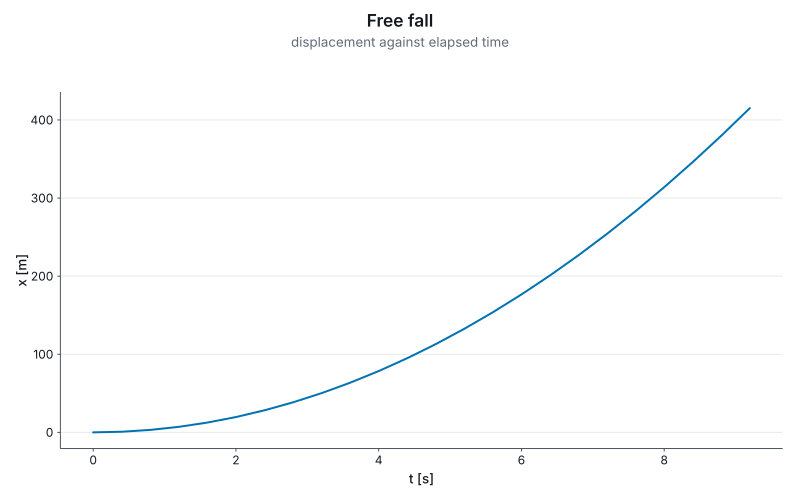
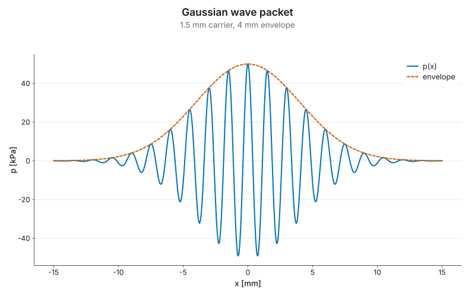
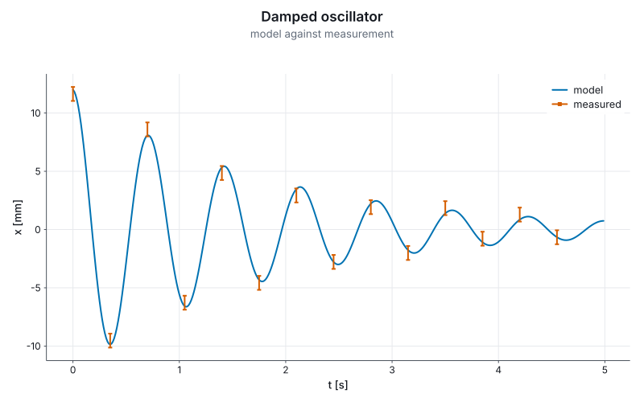
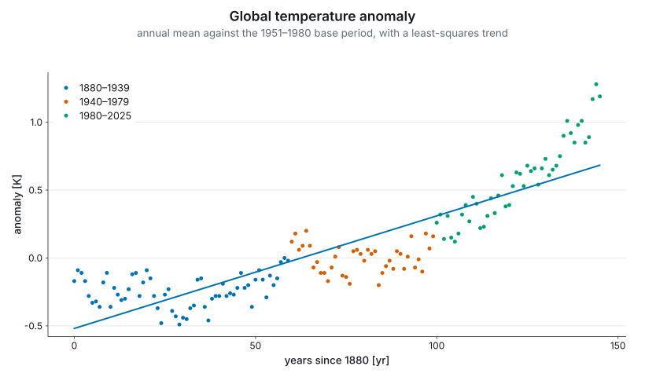
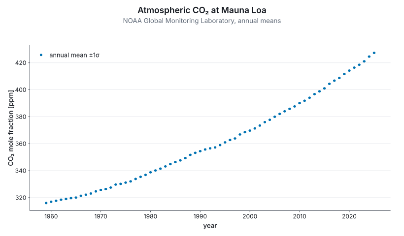

# Marey

[](https://github.com/Jonathan-Schaefer-git/marey/actions/workflows/ci.yml)
[](https://www.nuget.org/packages/Marey.Plot)

A plotting library for F# where the compiler checks your units, and the axes label themselves.

> Named for **Étienne-Jules Marey** (1830–1904), who invented the graphical method in experimental
> science: record a physical quantity as a curve against time, and read the physics off the curve.

```fsharp
#r "nuget: Marey.Plot"
#r "nuget: Marey.Backend.Svg"

open Marey

let t = Array.init 24 (fun i -> float i * 0.4<s>)
let x = t |> Array.map (fun t -> 0.5 * 9.81<m/s^2> * t * t)

Chart.line U.second U.metre t x
|> Chart.withTitle "Free fall"
|> Chart.toSvg SvgBackend.render "fall.svg" (Chart.size 800.0 500.0)
```



Nothing above configures an axis. The scale, the domain, the SI prefix, the tick values, the tick
labels and both axis titles are derived from the two unit witnesses. `x` is never annotated as a
length — `0.5 * 9.81<m/s^2> * t * t` has type `float<m>`, which the compiler derives — and plotting
seconds against seconds on these axes is a compile error.

## Install

```
dotnet add package Marey.Plot
dotnet add package Marey.Backend.Svg
```

`Marey.Html` sits at the top of the graph, so referencing it alone brings the rest.

## Units, end to end

Data spanning 1e-9 to 5e-9 metres produces an axis reading `nm` with ticks `1, 2, 3, 4, 5`.
Kilopascals are labelled as kilopascals:



The unit registry is keyed on the seven-element SI dimension vector rather than on strings, so
anything that composes to a newton prints `N`. Units with no SI name are covered as long as the
composition is stated: `U.div Derived.volt U.metre` renders `V·m⁻¹`, and `MV·m⁻¹` when prefixed.
Nothing is inferred — a bare dimension is never factorised, because the same vector is both `J/K`
and `N·m/K`.

Affine units carry their offset: degrees Celsius converts by shift as well as factor, an
electronvolt axis reads `keV` rather than `kJ`, and a mass rescaled by 10⁻⁶ prints `mg` against the
gram rather than `µkg`.

## Figures that belong in a LaTeX document

Swapping the theme turns the same figure into `tikzpicture` source. It is typeset by the same
engine as the rest of the document, so **the figure inherits the document's fonts**, and the axis
titles are set by `siunitx` from the unit witnesses:

```fsharp
figure
|> Chart.withTheme Theme.tikz
|> Chart.toFile TikzBackend.render "fall.tex" (Chart.size 320.0 200.0)
```

```tex
\node[anchor=north,font=\fontsize{9}{10.8}\selectfont] at (133.59bp,15.825bp) {t [\qty{}{\second}]};
\node[anchor=base,rotate=90,font=\fontsize{9}{10.8}\selectfont] at (15.825bp,69.075bp) {x [\qty{}{\metre}]};
```

## The usual scientific figure

A model curve, measured points, error bars, and a legend naming only the layers that were named:



## When the data is a table

Two arrays and a chart call is the right shape for two arrays. When the data is a table and the
figure has more than two things in it, `plot` says what each column means in one place:

```fsharp
plot trials {
    x U.second (fun r -> r.Time)
    y U.metre  (fun r -> r.Displacement)
    color      (fun r -> r.Sample)
    layer GeomPoint
    fit
}
```



Each dimensioned channel takes its witness beside the accessor, and the accessor is checked against
it — naming `r.Displacement` under `U.second` does not compile. Categorical channels take no
witness, because a category carries no dimension: `color` gives one colour per level and a legend
that names them, while `colorBy U.kelvin` gives a colorbar labelled from the witness.

`fit` is one of the statistics, and its slope is a typed number as well as a line on the page. A
fit of metres against seconds has a slope of type `float<m/s>`:

```fsharp
let fitted = Stat.regression U.second U.metre t x
let speed: float<m/s> = fitted.Slope
```

`facetWrap` draws one panel per level of a key over shared axes, so a difference between panels is
a difference in the data.

## Real data, and where the units story stops

Units are transformative for physical measurements and irrelevant for a mole fraction in ppm,
which is dimensionless. A dimensionless axis is rendered with no unit brackets rather than `[1]`,
values with no unit to carry a prefix are not rescaled, and the label is left to the caller:



The [`examples/`](examples/) directory has six worked figures, three of them on real committed
datasets.

## What is in the box

| Package | |
|---|---|
| `Marey.Core` | Dimension vectors, unit witnesses, unit-indexed geometry, scales, and the nine-case scene IR. Zero dependencies. |
| `Marey.Units` | SI, 22 derived and 18 non-SI unit witnesses; canonicalisation, prefix selection, and Unicode/ASCII/LaTeX/siunitx rendering. |
| `Marey.Plot` | `Chart` and the `plot` encoding block, twelve geoms, colour/shape/size channels, statistics, facets, six themes, colour-blind-safe palettes with a validator, constraint layout, and the axis and legend compilers. No backend reference. |
| `Marey.Backend.Svg` | SVG. Pure F#, zero dependencies, byte-identical across renders. |
| `Marey.Backend.Tikz` | `tikzpicture` source for LaTeX, with `siunitx` units and inherited fonts. |
| `Marey.Html` | HTML renderings of nine Marey types for a notebook cell. Host-neutral. |
| `Marey.Verso` | The [Verso](https://github.com/DataficationSDK/Verso) notebook extension, so a bare `Figure` displays as a figure. |

## Notebooks

In [Verso](https://github.com/DataficationSDK/Verso) with the `Marey.Verso` extension installed, a
cell whose value is a `Figure` shows the figure — no `.Show()`, no save-then-open, no display call.
Without the extension, render to SVG and the built-in formatter draws it, with nothing installed.

## Building

```
dotnet build
dotnet test
```

The suite is FsCheck property suites for the dimension group laws, all seven scale kinds, ticks,
interpolation, colour and the scene IR; 35 golden baselines in SVG *and* `tikzpicture` source; a
real `pdflatex` compile gate; a rasterised ink gate that checks the picture is not blank; and
executable checks over every example in [the guide](docs/guide.md) and in [`examples/`](examples/).

## Documentation

- **[The guide](docs/guide.md)** — everything the library does today, with a runnable example for
  each part. Every example in it is extracted and executed by the test suite.
- **[Examples](examples/)** — six standalone scripts, also executed by the test suite.
- **[Why Marey is like this](docs/why.md)** — the case for a unit witness over a string label,
  what the other design decisions buy, what they cost, and when not to use the library.
- **[Changelog](CHANGELOG.md)** — what changed in each release, and what is still known to be
  wrong.
- **[Contributing](CONTRIBUTING.md)** — building, the golden baselines, and the three layering
  rules a change has to keep.

## Status

Pre-1.0, and versioned accordingly. The API is still free to move; breaking changes are listed in
the [changelog](CHANGELOG.md) with the reason and the replacement.

MIT licensed.
