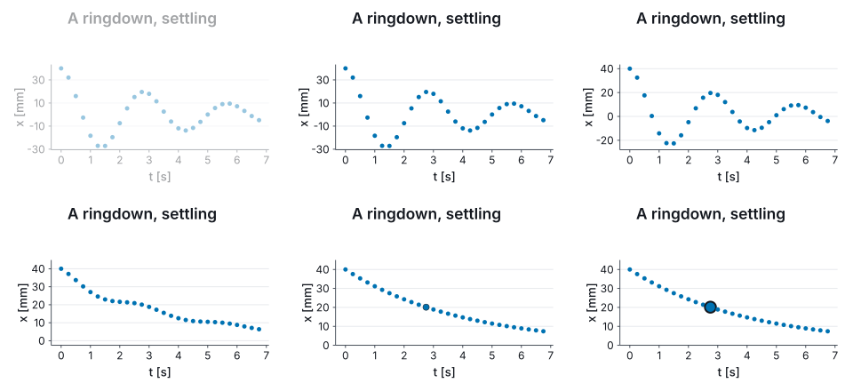

# Marey

[](https://github.com/Axym-Labs/marey/actions/workflows/ci.yml)
[](https://www.nuget.org/packages/Marey.Plot)

A plotting library for F# where the compiler checks your units, and the axes label themselves.

> Named for **Étienne-Jules Marey** (1830–1904), who invented the graphical method in experimental
> science: record a physical quantity as a curve against time, and read the physics off the curve.

```fsharp
#r "nuget: Marey.Plot"
#r "nuget: Marey.Backend.Svg"

open Marey
open Marey.UnitsOfMeasure

let t = Array.init 24 (fun i -> float i * 0.4<s>)
let x = t |> Array.map (fun t -> 0.5 * 9.81<m/s^2> * t * t)

Chart.line U.second U.metre t x
|> Chart.withTitle "Free fall"
|> Chart.toSvg SvgBackend.render "fall.svg" (Chart.size 800.0 500.0)
```


Nothing above configures an axis. The scale, the domain, the SI prefix, the tick values, the tick
labels and both axis titles are derived from the two unit witnesses. `x` is never annotated as a
length — `0.5 * 9.81<m/s^2> * t * t` has type `float<m>`, which the compiler derives — and plotting
seconds against seconds on these axes is a compile error.

## Install

```
dotnet add package Marey.Plot
dotnet add package Marey.Backend.Svg
```

`Marey.Html` sits at the top of the graph, so referencing it alone brings the rest. For PNG and
PDF, add `Marey.Backend.Skia`, which depends on SkiaSharp and is a separate package for that
reason. `Marey.Backend.Gpu` draws the same on an OpenGL context, offscreen.

## Units, end to end

Data spanning 1e-9 to 5e-9 metres produces an axis reading `nm` with ticks `1, 2, 3, 4, 5`.
Kilopascals are labelled as kilopascals:


The unit registry is keyed on the seven-element SI dimension vector rather than on strings, so
anything that composes to a newton prints `N`. Units with no SI name are covered as long as the
composition is stated: `U.div Derived.volt U.metre` renders `V·m⁻¹`, and `MV·m⁻¹` when prefixed.
Nothing is inferred — a bare dimension is never factorised, because the same vector is both `J/K`
and `N·m/K`.

Affine units carry their offset: degrees Celsius converts by shift as well as factor, an
electronvolt axis reads `keV` rather than `kJ`, and a mass rescaled by 10⁻⁶ prints `mg` against the
gram rather than `µkg`.

## Figures that belong in a LaTeX document

Swapping the theme turns the same figure into `tikzpicture` source. It is typeset by the same
engine as the rest of the document, so **the figure inherits the document's fonts**, and the axis
titles are set by `siunitx` from the unit witnesses:

```fsharp
figure
|> Chart.withTheme Theme.tikz
|> Chart.toFile TikzBackend.render "fall.tex" (Chart.size 320.0 200.0)
```

```tex
\node[anchor=north,font=\fontsize{9}{10.8}\selectfont] at (133.59bp,15.825bp) {t [\qty{}{\second}]};
\node[anchor=base,rotate=90,font=\fontsize{9}{10.8}\selectfont] at (15.825bp,69.075bp) {x [\qty{}{\metre}]};
```

## The usual scientific figure

A model curve, measured points, error bars, and a legend naming only the layers that were named:


## When the data is a table

Two arrays and a chart call is the right shape for two arrays. When the data is a table and the
figure has more than two things in it, `plot` says what each column means in one place:

```fsharp
plot trials {
    x U.second (fun r -> r.Time)
    y U.metre  (fun r -> r.Displacement)
    color      (fun r -> r.Sample)
    layer GeomPoint
    fit
}
```


Each dimensioned channel takes its witness beside the accessor, and the accessor is checked against
it — naming `r.Displacement` under `U.second` does not compile. Categorical channels take no
witness, because a category carries no dimension: `color` gives one colour per level and a legend
that names them, while `colorBy U.kelvin` gives a colorbar labelled from the witness.

`fit` is one of the statistics, and its slope is a typed number as well as a line on the page. A
fit of metres against seconds has a slope of type `float<m/s>`:

```fsharp
let fitted = Stat.regression U.second U.metre t x
let speed: float<m/s> = fitted.Slope
```

`facetWrap` draws one panel per level of a key over shared axes, so a difference between panels is
a difference in the data.

## Real data, and where the units story stops

Units are transformative for physical measurements and irrelevant for a mole fraction in ppm or a
column of revenue. They are opt-in: `open Marey.UnitsOfMeasure` is what makes every chart take a
witness, and without it a chart takes plain arrays with a unit per axis that may be stated or left
out.

```fsharp
open Marey

Chart.Errorbar(years, mean, uncertainty)                 // no unit stated, no bracket, no prefix
Chart.Line(ts, xs, xUnit = U.second, yUnit = U.metre)    // stated: labelled, prefixed, checked
```

A stated unit still labels, prefixes and checks, at run time rather than at compile time; a unit
left out claims nothing, and the label is left to the caller. A unit known only as text is read in
UDUNITS-2's syntax, `U.parse "V/m"`:


The [`examples/`](examples/) directory has fifteen worked scripts, three of them on real committed
datasets.

## A figure that moves

An animation is a **pure function of time**, so seeking is evaluation: `anim.At 2.7<s>` is a
direct call, frames come out in any order, and a render is `Array.Parallel.map` with no scheduler.
The storyboard block writes the sequence:

```fsharp
open Marey.Storyboard

let intro =
    scene {
        let! curve = draw measured |> over 1.2<s>
        do! wait 0.5<s>
        do! parallel' [ curve |> morphTo fitted   |> over 2.0<s> |> ease Ease.cubicInOut
                        curve |> zoomToY (0.0, 0.045) |> over 2.0<s> |> ease Ease.cubicInOut ]
        do! highlight curve.[peak]
    }

let anim = animate 32 (Chart.size 320.0 220.0) intro
```



`let!` binds a **name** for something on stage, not the animation — which is what lets `curve` be
referred to three more times. The whole shot is laid out **once**, against the union of every
state sampled, so the panel holds still while the data moves rather than crawling sideways as the
tick labels gain a digit. And `curve.[peak]` splits that scatter's single batched `Markers` node
three ways, so one mark has something to highlight — two extra nodes rather than one per point,
and only when something is named.

Rendering it is a `map` over the frame times, on as many threads as there are:

```fsharp
let film = Film.ofStory 32 (Chart.size 320.0 220.0) intro

film
|> Frames.write FramePass.Concurrent SkiaBackend.renderPng (FrameTarget.into "out" ".png") 30.0
```

The two passes produce the same bytes in the same order, and a gate says so frame for frame on
both backends. That holds because the contract is written down rather than assumed: an `IBackend`
is single-threaded and what crosses threads is a renderer *function*, while an `ITextMeasurer`
must be thread-safe and exactly one of them serves a whole film — not for speed, but because font
resolution walks a family stack against whatever is installed, and a measurer per thread is a
chance for one frame of a video to be set in a different typeface from the frame before it.

## From C#

C# has the unit-optional mode, with every witness under one name and the combinators as extension
methods, in the `Marey.CSharp` namespace of the same packages:

```csharp
using Marey;
using Marey.CSharp;

Chart.Line(ts, xs, xUnit: Units.Second, yUnit: Units.Metre)
    .WithTitle("Free fall")
    .Save(SvgRenderer.Render, "fall.svg", 800, 500);
```

## What is in the box

| Package | |
|---|---|
| `Marey.Core` | Dimension vectors, unit witnesses, unit-indexed geometry, scales, and the ten-case scene IR. Zero dependencies. |
| `Marey.Units` | SI, 22 derived and 18 non-SI unit witnesses; canonicalisation, prefix selection, and Unicode/ASCII/LaTeX/siunitx rendering. |
| `Marey.Plot` | `Chart` and the `plot` encoding block, thirteen geoms (hexbin the newest), colour/shape/size channels, statistics (loess and seeded bootstrap intervals among them), facets, six themes, colour-blind-safe palettes with a validator, constraint layout, the axis and legend compilers, the `scene` storyboard block, and the parallel frame writer. No backend reference. |
| `Marey.Backend.Svg` | SVG. Pure F#, zero dependencies, byte-identical across renders. |
| `Marey.Backend.Tikz` | `tikzpicture` source for LaTeX, with `siunitx` units and inherited fonts. |
| `Marey.Backend.Skia` | PNG and vector PDF, and real text shaping through HarfBuzz. Depends on SkiaSharp. |
| `Marey.Backend.Gpu` | The Skia backend's drawing on an OpenGL 3.3 context, offscreen: one context on its own thread, callable from any thread. Depends on Silk.NET's GLFW and OpenGL bindings. |
| `Marey.Anim` | Animation as a pure function of time: a seekable, composable `Anim<'a>`, twenty-eight easings, and arc-length path morphing. Depends on `Marey.Core` alone. |
| `Marey.Fields` | Scalar and vector fields on dimensioned planes, phase spaces included: grids, gradient, divergence, curl and the Jacobian in the units the types work out; heatmaps, contours, filled bands, quivers with a key, evenly spaced streamlines and line-integral convolution; phase portraits with fixed points classified and eigenvalues in `1/'t`. |
| `Marey.Tools.Video` | Encoding a rendered frame sequence to video by shelling out to `ffmpeg`, degrading to the numbered frames when it is absent. |
| `Marey.Tools.Tex` | Mathematical typesetting: TeX source on a scene's text runs becomes vector outlines, through `latex` and `dvisvgm`, so every backend draws it. Degrades to plain text when TeX is absent. |
| `Marey.Toolchain` | Resolution and invocation of the external programs Marey drives but does not ship. Zero dependencies. |
| `Marey.Interact` | Typed controls on a figure, composed by the `interact` block and stepped by a pure function a notebook drives: zoom and pan by dragging, a readout in the axes' own units, and recordings that replay as films. |
| `Marey.Html` | HTML renderings of twelve Marey types for a notebook cell, including a film as a playing flipbook and a live figure's page. Host-neutral. |
| `Marey.Verso` | The [Verso](https://github.com/DataficationSDK/Verso) notebook extension, so a bare `Figure` displays as a figure and a figure with controls is live. |

## Notebooks

In [Verso](https://github.com/DataficationSDK/Verso) with the `Marey.Verso` extension installed, a
cell whose value is a `Figure` shows the figure — no `.Show()`, no save-then-open, no display call.
Without the extension, render to SVG and the built-in formatter draws it, with nothing installed.

**A `Film` plays.** An animation built with the `scene { … }` block displays as a looping flipbook
in the cell — its frames stacked in one SVG and cycled with SMIL — so seeing what you just
animated needs no encoder, no video file and no round trip through the filesystem.

**A figure with controls is live.** A slider's unit is part of its type, so a slider over coulombs
per metre hands the view a `float<C/m>` and labels itself `2 nC·m⁻¹`:

```fsharp
interact {
    let! lambda = Control.slider lineCharge "λ" 0.5e-9<C/m> 5.0e-9<C/m> 2.0e-9<C/m>
    and! half = Control.slider U.metre "d/2" 0.2<m> 1.0<m> 0.6<m>
    return potentialMap lambda half
}
```

The reader moves a slider and the kernel draws the figure again, sending only what changed when
that is smaller. Dragging zooms, double-clicking resets, and the pointer reads the data under it
in the axes' own units. The figure is laid out once over the states the controls can reach, so the
plot area holds still while the numbers move. This needs a Verso newer than 1.2.2; anywhere else
the same cell shows the figure with its controls disabled.

## Building

```
dotnet build
dotnet test
```

The suite is FsCheck property suites for the dimension group laws, all seven scale kinds, ticks,
interpolation, colour and the scene IR; golden baselines in SVG *and* `tikzpicture` source; a real
`pdflatex` compile gate; rasterised ink gates over the compiled TeX, the rendered PNG and the
rendered PDF, checking the picture is not blank and is the right way up; an assertion over the
built assembly graph that no vector package can see SkiaSharp; and executable
checks over every example in [the guide](docs/guide.md) and in [`examples/`](examples/).

Several of those gates shell out, and every one of them **passes when the program it needs is
absent** — right on a laptop without a TeX installation, and worthless as evidence. So each run
prints a census of all nine external dependencies and what became of them, and
`MAREY_REQUIRE_TOOLCHAIN=1` turns an absent one into a failure. CI sets it.

## Documentation

- **[The guide](docs/guide.md)** — everything the library does today, with a runnable example for
  each part. Every example in it is extracted and executed by the test suite.
- **[Examples](examples/)** — fifteen standalone scripts and a notebook, also executed by the test
  suite.
  [`reel.fsx`](examples/reel.fsx) is the demo reel: the whole library in one shot, ending in an
  `.mp4`.
- **[Why Marey is like this](docs/why.md)** — the case for a unit witness over a string label,
  what the other design decisions buy, what they cost, and when not to use the library.
- **[Changelog](CHANGELOG.md)** — what changed in each release, and what is still known to be
  wrong.
- **[Contributing](CONTRIBUTING.md)** — building, the golden baselines, and the four layering
  rules a change has to keep.

## Status

Pre-1.0, and versioned accordingly. The API is still free to move; breaking changes are listed in
the [changelog](CHANGELOG.md) with the reason and the replacement.

MIT licensed.
