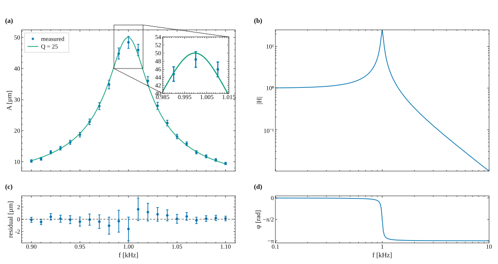
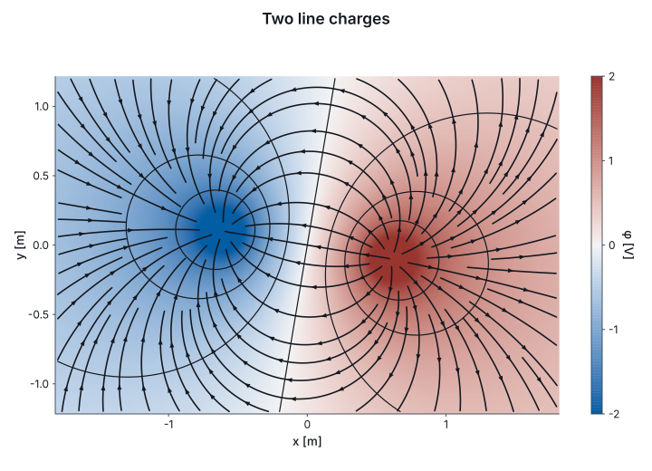
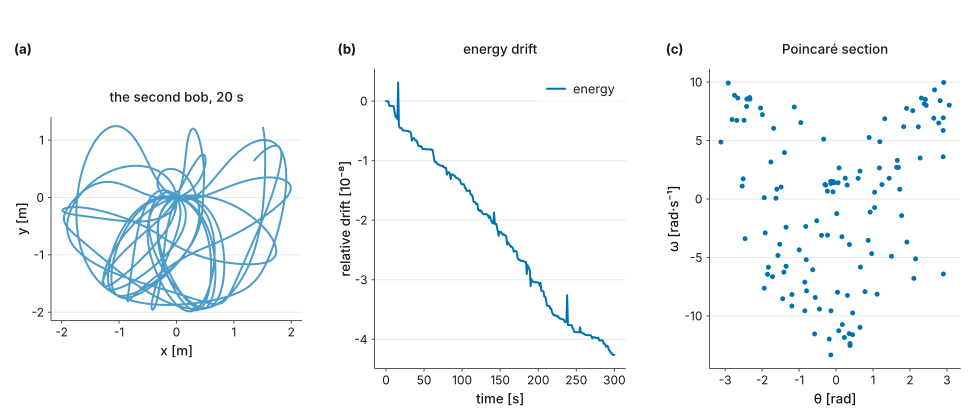
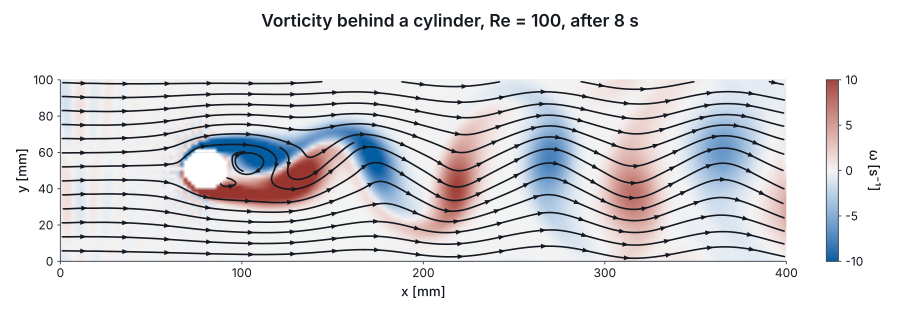
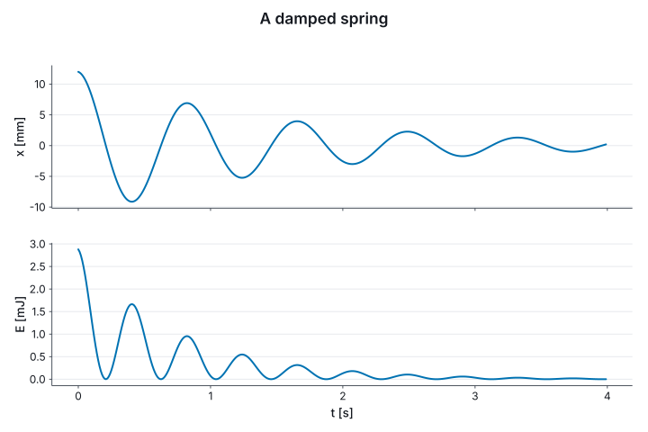

# Marey

[](https://github.com/Axym-Labs/marey/actions/workflows/ci.yml)
[](https://www.nuget.org/packages/Marey)

Figures, fields, simulations and animations for F#, where the compiler checks the units and the
axes label themselves.

> Named for **Étienne-Jules Marey** (1830–1904), who invented the graphical method in experimental
> science: record a physical quantity as a curve against time, and read the physics off the curve.

<p align="center">
  <a href="docs/guide/06-paper.md"></a>
</p>
<p align="center">
  <a href="docs/guide/07-fields.md"></a>
  <a href="docs/guide/12-interaction.md"></a>
</p>
<p align="center">
  <a href="docs/guide/08-simulation.md"></a>
</p>
<p align="center">
  <a href="docs/guide/10-storyboard.md"></a>
  <a href="docs/guide/08-simulation.md"></a>
</p>

Each picture is drawn by the code in [the guide](docs/guide/README.md) above it, and the test
suite redraws them all and fails when one no longer matches.

## The idea

A chart takes a *unit witness* for each axis, `U.second`, `U.metre`, and the compiler checks it
against the data's units of measure. From the witness and the numbers the figure takes everything
else: the axis titles, the SI prefix, the ticks, the unit a statistic comes out in, and the check
that two series on one axis agree. Plotting seconds against a metres axis does not compile. The
same idea runs through the rest: a field's gradient is in the units the types work out, a slider
over kelvin hands the view a temperature, and an integrator checks that an acceleration is one.

## Install

```
dotnet add package Marey
```

or `#r "nuget: Marey"` in a script. `Marey` brings units, figures, fields, simulations, animation,
live figures, and SVG, TikZ and HTML output. PNG and PDF are `Marey.Backend.Skia`; a window and the
GPU are `Marey.Backend.Gpu`; typeset text and video are `Marey.Tools.Tex` and `Marey.Tools.Video`.
In a [Verso](https://github.com/DataficationSDK/Verso) notebook, a first cell of
`#!extension Marey.Verso` makes a figure display as a figure and a figure with controls live.

## A damped spring

```fsharp output=readme-spring size=720x480
#r "nuget: Marey"

open Marey
open Marey.UnitsOfMeasure

let t = Array.init 400 (fun i -> float i * 0.01<s>)
let x = t |> Array.map (fun t -> 0.012<m> * exp (-t / 1.5<s>) * cos (2.0 * System.Math.PI * 1.2<Hz> * t))
let stiffness = 40.0<N/m>

let spring =
    Chart.line U.second U.metre t x
    |> Chart.above (Chart.line U.second U.joule t (x |> Array.map (fun x -> 0.5 * stiffness * x * x)))
    |> Chart.shareX
    |> Chart.withTitle "A damped spring"

spring
```



Nothing set an axis. The displacement was computed in metres and reads `x [mm]`; the energy,
`½ k x²` with `k` in N/m, is a `float<J>` because the compiler worked it out, and reads in mJ. The
time axis is written once, under the lower panel. The same value is a `tikzpicture` for a LaTeX
document, typeset in the document's font with `siunitx` units:

```fsharp
spring |> Chart.toSvg SvgBackend.render "spring.svg" (Chart.size 720.0 480.0)
spring |> Chart.withTheme Theme.tikz |> Chart.toFile TikzBackend.render "spring.tex" (Chart.size 720.0 480.0)
```

## What it does

- **Figures**: thirteen kinds of mark, rules, spans and annotations; log, symlog, power and
  reciprocal scales; stated and named ticks; a second y axis and secondary axes through a map
  (§§[1](docs/guide/01-start.md)–[4](docs/guide/04-axes.md)).
- **Tables and statistics**: the `plot` block, colour, shape and size channels, loess, bootstrap
  intervals in the statistic's unit, facets ([§5](docs/guide/05-tables.md)).
- **Papers**: panels on one grid, spans, mosaics, stated proportions, shared axes, insets, panel
  letters, a journal's framed box, TikZ with `siunitx`, vector PDF ([§6](docs/guide/06-paper.md)).
- **Fields**: derivatives in their units, heatmaps, contours, quivers, streamlines,
  line-integral convolution, phase portraits with fixed points classified ([§7](docs/guide/07-fields.md)).
- **Simulation**: integrators typed by the shape of the state, invariants, events, Poincaré
  sections, grid solvers and fluids, on the CPU or the GPU ([§8](docs/guide/08-simulation.md)).
- **Motion**: animation as a function of time, the `scene` storyboard, films that hold their
  layout still, video, typeset formulas (§§[9](docs/guide/09-animation.md)–[10](docs/guide/10-storyboard.md)).
- **Live**: figures in Verso notebooks, controls in units, zoom, pan and a readout, recordings
  that replay as films, a window, and the browser through Fable (§§[11](docs/guide/11-notebooks.md)–[13](docs/guide/13-gpu-window-browser.md)).
- **C#**: the same figures without units of measure, with units stated as arguments
  ([§14](docs/guide/14-csharp.md)).

## The packages

| Package | |
|---|---|
| `Marey` | The packages below that need no native library or external program, in one reference. |
| `Marey.Core`, `Marey.Units` | Dimensions, unit witnesses, scales, colour, and the scene every backend draws. |
| `Marey.Plot` | `Chart`, the `plot` block, layout, themes, the storyboard. |
| `Marey.Anim`, `Marey.Fields`, `Marey.Sim` | Animation, fields, simulation. |
| `Marey.Interact`, `Marey.Html` | Live figures, and HTML for a notebook cell. |
| `Marey.Backend.Svg`, `Marey.Backend.Tikz` | SVG, and `tikzpicture` source for LaTeX. |
| `Marey.Backend.Skia` | PNG and vector PDF with text shaped by HarfBuzz. Brings SkiaSharp. |
| `Marey.Backend.Gpu` | The GPU, offscreen or in a window. Brings Silk.NET. |
| `Marey.Backend.Web` | A canvas in a browser, for a Fable app. |
| `Marey.Tools.Tex`, `Marey.Tools.Video` | Typeset text through `latex` and `dvisvgm`, video through `ffmpeg`. |
| `Marey.Verso` | The Verso notebook extension, loaded by `#!extension Marey.Verso`. |

## Documentation

- **[The guide](docs/guide/README.md)**, a tour of everything in fifteen sections, every block of it run by the test suite.
- **[Examples](examples/)**, standalone scripts and a notebook, also run by the test suite.
- **[Why Marey is like this](docs/why.md)**: the case for a unit witness over a string label, what the other decisions cost, and when not to use the library.
- **[Compatibility](docs/compatibility.md)** and **[Not in 1.0](docs/not-in-1.0.md)**.
- **[Changelog](CHANGELOG.md)** and **[Contributing](CONTRIBUTING.md)**.

## Building

```
dotnet build
dotnet test
```

The suite holds property tests for the dimension algebra, the scales, ticks, interpolation, colour
and the scene; golden baselines in SVG and `tikzpicture` source; a `pdflatex` compile; ink checks
over the compiled TeX, the PNG and the PDF; the guide, the README and the examples run; and the
same baselines drawn under Fable and Node. Gates that need an external program report it absent
rather than fail, and `MAREY_REQUIRE_TOOLCHAIN=1`, which CI sets, makes an absent one a failure.

## Status

Pre-1.0. The next release is 1.0.0, and [Compatibility](docs/compatibility.md) says what it will
promise. MIT licensed.
