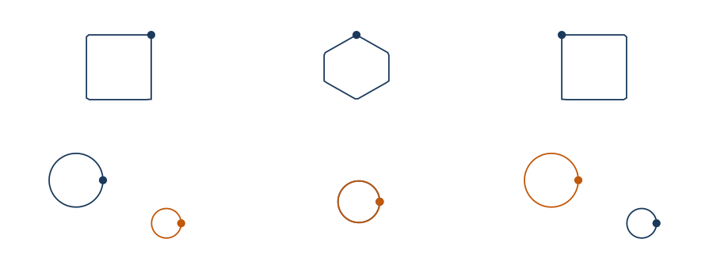

# The guide

Every part of the library, with a runnable example for each.

**Every `fsharp` block below is executed by the test suite.** `GuideTests.fs` extracts them in
order, concatenates them into one script and runs it under `dotnet fsi`; if a block stops compiling
or starts throwing, that test fails. Blocks marked `fsharp-error` are the exception — they are shown
*because* they do not compile, and the checker skips them.

The blocks form one continuous session, so bindings introduced early are still in scope later.

---

## Contents

1. [Installing](#1-installing)
2. [The first figure](#2-the-first-figure)
3. [Units, and the one error a compiler cannot catch](#3-units-and-the-one-error-a-compiler-cannot-catch)
4. [Scales](#4-scales)
5. [Geoms](#5-geoms)
6. [Layers and the legend](#6-layers-and-the-legend)
7. [Axes](#7-axes)
8. [Panels](#8-panels)
9. [Themes](#9-themes)
10. [Colour](#10-colour)
11. [Categories, and the channels beyond x and y](#11-categories-and-the-channels-beyond-x-and-y)
12. [Statistics](#12-statistics)
13. [The encoding block](#13-the-encoding-block)
14. [Facets](#14-facets)
15. [Output: SVG, TikZ, PNG, PDF](#15-output-svg-tikz-png-pdf)
16. [Animation](#16-animation)
17. [Notebooks](#17-notebooks)
18. [The scene IR](#18-the-scene-ir)
19. [Escape hatches](#19-escape-hatches)

---

## 1. Installing

One package reference is enough for the common case. `Marey.Html` depends on Plot, which depends
on Units and Core, so all of it arrives transitively.

```fsharp
#r "nuget: Marey.Html"

open Marey
```

| Package | Take it when |
|---|---|
| `Marey.Core` | The `Scene` IR, colour, scales and geometry, and nothing else. Zero dependencies. |
| `Marey.Units` | SI + 22 derived + 18 non-SI unit witnesses, and self-labelling axes. |
| `Marey.Plot` | `Chart`, the `plot` block, geoms, channels, statistics, facets, themes, palettes, layout. No backend reference — see §15. |
| `Marey.Backend.Svg` | Rendering to SVG. |
| `Marey.Backend.Tikz` | Rendering to `tikzpicture` source for LaTeX. |
| `Marey.Backend.Skia` | Rendering to PNG or PDF, and real text shaping. The only one with third-party dependencies, and native ones at that — see §15. |
| `Marey.Anim` | Animation as a pure function of time: `Anim<'a>`, the easing catalogue and path morphing. Depends on `Marey.Core` alone — see §16. |
| `Marey.Html` | HTML renderings of nine Marey types, for a notebook cell. Host-neutral. |
| `Marey.Verso` | The [Verso](https://github.com/DataficationSDK/Verso) notebook extension. Installed *into the host*, not referenced from user code. |

---

## 2. The first figure

```fsharp
let t = Array.init 24 (fun i -> float i * 0.4<s>)
let x = t |> Array.map (fun t -> 0.5 * 9.81<m/s^2> * t * t)

let fall =
    Chart.line U.second U.metre t x
    |> Chart.withTitle "Free fall"
    |> Chart.withSubtitle "displacement against elapsed time"
```

Nothing was configured, and the figure already carries:

- that the x axis is **seconds** and the y axis is **metres**, from the two unit witnesses;
- that `x` is a length at all — `0.5 * 9.81<m/s^2> * t * t` has type `float<m>`, derived by the
  compiler rather than annotated;
- the axis titles (`t [s]`, `x [m]`), the tick values, and the SI prefix appropriate to the
  magnitudes actually present.

The same call on nanometre-scale data relabels itself:

```fsharp
let small = t |> Array.map (fun v -> 1.0e-9<m/s> * v)
let nm = Chart.line U.second U.metre t small
let nmSvg = nm |> Chart.render SvgBackend.render (Chart.size 480.0 300.0)

// The axis says nanometres, and the ticks are small integers rather than 1e-9.
printfn "nanometre axis: %b" (nmSvg.Contains "[nm]")
```

---

## 3. Units, and the one error a compiler cannot catch

A `float<m>` and a `float<s>` are different types, so most dimensional mistakes are build errors.
The following does not compile, and is shown for the error it produces:

```fsharp-error
// error FS0001: Type mismatch. Expecting a 'float<m> []' but given a 'float<s> []'
Chart.line U.second U.metre t t
```

The remaining case is the one that *is* well-typed. Two separately-correct series can still be
wrong to put on one axis, which is caught when the figure is compiled rather than when it is
built:

```fsharp
let temperature = t |> Array.map (fun v -> 293.0<K> + 0.5<K/s> * v)

let mixed =
    Chart.line U.second U.metre t x
    |> Chart.withName "displacement"
    |> Chart.addLine U.second U.kelvin t temperature
    |> Chart.withName "temperature"

let clash =
    try
        mixed |> Chart.render SvgBackend.render (Chart.size 400.0 250.0) |> ignore
        None
    with e ->
        Some e.Message

printfn "dimension clash reported: %b" clash.IsSome
```

That error is not a failed conversion — each array is well typed on its own. It is the one
dimensional mistake a type system cannot see, because it does not exist until the two series are
placed on a single axis.

### The unit witnesses

`U<'u>` is the runtime witness for a compile-time measure: it carries the SI dimension vector, so
the library can canonicalise, prefix and label without parsing strings.

```fsharp
printfn "newton dim:  %s" (Dim.show (U.dim Derived.newton))
printfn "joule:       %s" (U.symbol Derived.joule)
printfn "celsius affine: %b" (U.isAffine NonSi.degreeCelsius)
```

`degreeCelsius` is affine, so its conversion to SI is not a factor alone.

Composing witnesses gets the *measure* right and the *name* wrong, which is the reason the
registry exists. `Derived.newtonByComposition` is built with `U.mul`/`U.div` from base witnesses
rather than stated outright, and stands next to the named one for comparison:

```fsharp
printfn "named:    %s" (U.symbol Derived.newton)
printfn "composed: %s" (U.symbol Derived.newtonByComposition)
printfn "same dimension: %b" (U.dim Derived.newton = U.dim Derived.newtonByComposition)
```

The composed symbol is `kg·m/s²` — correct, and not what an axis is labelled with. The registry is
keyed by the `Dim` itself, so the canonical name is recovered from the dimension rather than by
matching strings, in all four spellings the renderers need:

```fsharp
let canonical = UnitRegistry.tryCanonical UnitRegistry.si (U.dim Derived.newtonByComposition)
printfn "canonical: %A" (canonical |> Option.map (fun u -> u.Unicode, u.Ascii, u.Siunitx))
```

Most compositions have no canonical name, because most combinations of dimensions are not named
units. An electric field is one: `V/m` is not in SI's table, and its dimension spelled out is
`kg·m·s⁻³·A⁻¹`, which is correct and unreadable. Where the registry has no name for the whole
dimension, the axis is labelled from the composition as written:

```fsharp
let fieldUnit = U.div Derived.volt U.metre
printfn "field: %s" (UnitDisplay.unitText Unicode UnitRegistry.si Prefix.none fieldUnit)
printfn "siunitx: %s" (UnitDisplay.unitText Siunitx UnitRegistry.si Prefix.none fieldUnit)
```

That is `V·m⁻¹` and `\qty{}{\volt\per\metre}` — and a prefix lands on the leading factor, so a
megavolt-per-metre axis reads `MV·m⁻¹`. A bare dimension is never factorised: the dimension of
`J/K` is also the dimension of `N·m/K`, so only a supplied factorisation is read back. A registered
name still wins, so `U.mul Derived.newton U.metre` is `J`.

Non-SI witnesses cover the units physics actually writes in: `electronvolt`, `angstrom`,
`parsec`, `lightYear`, `dalton`, `atmosphere`, `bar`, `barn`, `calorie`, `gauss`, `litre`,
`minute`, `hour`, `day`, `year`, `astronomicalUnit`, `degreeCelsius`, `degreeFahrenheit`.

---

## 4. Scales

Seven kinds, all invertible, all tested for `inverse (forward x) = x`, monotonicity and endpoint
mapping over generated domains.

| Kind | Constructor |
|---|---|
| Linear | `Scale.linear` |
| Log (base 10, 2, e, arbitrary) | `Scale.log10`, `Scale.log2`, `Scale.ln`, `Scale.logBase` |
| Symlog — log that survives zero and negatives | `Scale.symlog` |
| Power | `Scale.power`, `Scale.sqrt` |
| Reciprocal | `Scale.reciprocal` |

The common case needs none of them directly: the kind is selected on the figure and the domain
follows from the data.

```fsharp
let decades = [| 1.0<m>; 10.0<m>; 100.0<m>; 1000.0<m>; 10000.0<m> |]
let response = [| 1.0<V>; 0.5<V>; 0.25<V>; 0.125<V>; 0.0625<V> |]

let logFigure =
    Chart.line U.metre Derived.volt decades response
    |> Chart.withXLog
    |> Chart.withTitle "Response against distance"
```

Build one directly to control the domain:

```fsharp
let logScale = Scale.log10 U.metre (1.0<m>, 1000.0<m>)
printfn "stated domain: %A" logScale.Domain

// Or derive one from the data, with a margin, and let it be nice:
printfn "from data:     %A" (Scale.domainOf x)
printfn "with margin:   %A" (Scale.paddedDomain 0.05 x)
```

Domains can be pinned on the figure too:

```fsharp
let framed =
    fall
    |> Chart.withYDomain 0.0 100.0
    |> Chart.withXDomain 0.0 10.0
```

Ticks walk a 1-2-5 ladder and return what falls out, so a theme's `TickCount` is a *target*
rather than a promise:

```fsharp
printfn "ticks: %A" (Ticks.linear 5 (0.0, 9.2))
```

---

## 5. Geoms

Each has a constructor that starts a figure, and most have an `add*` that layers onto the last
panel.

```fsharp
let categories = [| 1.0<s>; 2.0<s>; 3.0<s>; 4.0<s> |]
let counts = [| 3.0<m>; 7.0<m>; 4.0<m>; 9.0<m> |]
let sigma = [| 0.4<m>; 0.6<m>; 0.3<m>; 0.8<m> |]

let lineOnly    = Chart.line     U.second U.metre t x
let scatterOnly = Chart.scatter  U.second U.metre t x
let areaOnly    = Chart.area     U.second U.metre t x
let barOnly     = Chart.bar      U.second U.metre categories counts
let errorOnly   = Chart.errorbar U.second U.metre categories counts sigma
let stepOnly    = Chart.step     U.second U.metre categories counts
```

`errorbar` is two layers in one call — the bars and the centre points — and only one of them
appears in the legend. `step` draws a staircase; `Chart.stepWith` places the riser at the previous
sample (`StepBefore`) or halfway between (`StepMid`) instead of at the sample itself.

**A band** is two y series and the region between them — a confidence interval, an envelope, a
minimum and maximum. Both bounds are in the y unit, so an interval in the wrong unit does not
compile.

```fsharp
let lo = counts |> Array.map (fun v -> v - 1.0<m>)
let hi = counts |> Array.map (fun v -> v + 1.0<m>)

let withBand =
    Chart.line U.second U.metre categories counts
    |> Chart.addRibbon U.second U.metre categories lo hi
```

**Segments** join pairs of points, and **labels** annotate the series already on the figure —
`addLabels` reuses that layer's own positions and colour, so the labels stay on their marks.

```fsharp
let displacements =
    Chart.segment U.second U.metre categories counts (categories |> Array.map ((+) 0.5<s>)) hi

let annotated =
    Chart.scatter U.second U.metre categories counts
    |> Chart.addLabels [| "a"; "b"; "c"; "d" |]
```

**A heatmap** is tiles plus a colour channel. The cell size comes from the grid's own spacing, and
the third quantity carries its own unit, so the colorbar labels itself from the witness:

```fsharp
let cells =
    [| for gy in 0.0 .. 2.0 do
           for gx in 0.0 .. 3.0 -> gx * 1.0<s>, gy * 1.0<m> |]

let field =
    Chart.heatmap
        U.second
        U.metre
        U.kelvin
        (cells |> Array.map fst)
        (cells |> Array.map snd)
        (cells |> Array.map (fun (gx, gy) -> 280.0<K> + 4.0<K/s> * gx + 7.0<K/m> * gy))
    |> Chart.withColorLabel "T"
```

**Distributions by category** are box plots and violins. Both take one value per row and a key per
row; the rows are grouped, summarised or smoothed, and drawn one band per level:

```fsharp
let subject = [| "control"; "treated"; "control"; "treated"; "control"; "treated" |]
let yield' = [| 12.4<m>; 19.1<m>; 13.0<m>; 18.2<m>; 12.9<m>; 19.6<m> |]

let boxes = Chart.Category.boxplot U.metre subject yield'
```

The whiskers reach the most extreme observation within 1.5 × IQR of the box, and anything past
them is drawn as a point rather than absorbed into the whisker. The y domain covers those points,
so an outlier is never clipped by the panel edge.

`Chart.Category.violin` draws the same split as a kernel density instead of a summary. Every
violin in a figure shares one bandwidth, taken from the undivided sample, so a sparse level is not
smoothed harder than a populous one — and the widths are normalised together, so a level with more
rows draws a wider violin.

Per-layer style overrides apply to the most recently added layer:

```fsharp
let styled =
    Chart.line U.second U.metre t x
    |> Chart.withName "model"
    |> Chart.withColor Palette.vermillion
    |> Chart.withDash [| 4.0<px>; 2.0<px> |]
    |> Chart.addScatter U.second U.metre t.[..5] x.[..5]
    |> Chart.withName "measured"
    |> Chart.withMarker MarkSquare
    |> Chart.withOpacity 0.8
```

A style set explicitly survives a theme change; one left unset is recoloured. That asymmetry is
what makes `withTheme` safe to apply last:

```fsharp
let rethemed = styled |> Chart.withTheme Theme.dark
```

---

## 6. Layers and the legend

`withName` names the layer *most recently added*, which is why it reads as a suffix rather than an
argument. An unnamed layer stays out of the legend.

```fsharp
let twoSeries =
    Chart.line U.second U.metre t x
    |> Chart.withName "model"
    |> Chart.addScatter U.second U.metre t.[..5] (x.[..5] |> Array.map (fun v -> v * 0.98))
    |> Chart.withName "measured"
    |> Chart.withLegend LegendTopLeft
    |> Chart.withGrid true true
```

Placements: `LegendTopLeft`, `LegendTopRight`, `LegendBottomLeft`, `LegendBottomRight`,
`LegendNone`.

Adding a layer unifies the domains across the panel, so the series share axes rather than each
drawing its own.

---

## 7. Axes

Titles are derived, and every part is overridable.

```fsharp
let labelled =
    fall
    |> Chart.withXLabel "elapsed"
    |> Chart.withYLabel "drop"
```

The unit *spelling* is a presentation choice, so it lives on the theme with a per-axis override,
which is what makes `Theme.tikz` sufficient on its own to produce `siunitx` markup:

```fsharp
let ascii = fall |> Chart.withUnitStyle Ascii
```

`Unicode` (`m·s⁻²`) for screens, `Ascii` for terminals, `Latex`, and `Siunitx`
(`\qty{}{\metre\per\second\squared}`) for papers.

Scale kinds and domains, set per axis:

```fsharp
let axisWork =
    Chart.line U.metre Derived.volt decades response
    |> Chart.withXScaleKind (ScaleKind.Log 10.0)
    |> Chart.withYDomain 0.0 1.2
```

---

## 8. Panels

`beside` and `above` compose whole figures, and each panel keeps its own axes and scales.

```fsharp
let row =
    Chart.line U.second U.metre t x
    |> Chart.withPanelTitle "position"
    |> Chart.beside (Chart.scatter U.second U.metre t x |> Chart.withPanelTitle "samples")

let stacked =
    row
    |> Chart.above (Chart.bar U.second U.metre categories counts |> Chart.withPanelTitle "counts")

printfn "panels: %d, rows: %d, cols: %d" stacked.Panels.Length stacked.Rows stacked.Cols
```

Layout is a measure–arrange constraint grid, so a panel gets the space its contents need rather
than an equal share of the surface.

---

## 9. Themes

Six, all resolved values rather than stylesheet lookups: reading a style is a field access, and a
missing one is a build error.

| Theme | For |
|---|---|
| `Theme.modern` | **The default.** Screen-first: sans, flat panel, horizontal gridlines, no frames. |
| `Theme.publication` | A paper. Serif, hairline rules, no gridlines, no chartjunk. |
| `Theme.notebook` | `modern` with a tinted panel and vertical gridlines, so a figure reads as an object inside a cell. |
| `Theme.presentation` | Large type, for projection. |
| `Theme.dark` | Not an inversion — `#E8E8E8` on `#16181C`, and the palette swaps so Okabe–Ito's black is not invisible. |
| `Theme.tikz` | Serif metrics and `Siunitx` unit spelling. Selecting it is the whole configuration. |

```fsharp
let onDark = fall |> Chart.withTheme Theme.dark
```

Themes are values, so adjust rather than fork:

```fsharp
let mine =
    Theme.modern
    |> Theme.withPalette Palette.okabeIto
    |> Theme.withGrid false true
    |> Theme.withTickCount 4
    |> Theme.scaleType 1.15
```

`scaleType` scales every typographic size and leaves everything else alone. `withFontFamily`
affects layout as much as appearance: the family string is what the text measurer reads to decide
how much room a label needs, and for the TikZ backend — which emits no family and lets the document
supply the face — that measurement is all the family does.

Every theme can be measured, and the shipped ones are:

```fsharp
for theme in Theme.all do
    let r = Theme.validate theme
    printfn "%-13s text %6.2f  axis %6.2f  grid %5.2f  Ok=%b"
        r.Theme r.TextContrast r.AxisContrast r.GridContrast r.Ok
```

`GridContrast` is reported and deliberately *not* floored, since a gridline is not meant to compete
with the data. `TextContrast` and `AxisContrast` are floored at WCAG AAA and 3:1, and every shipped
theme is run through this check by the test suite.

---

## 10. Colour

`Color` converts to Oklab/Oklch, so mixing and ramps are perceptual rather than sRGB arithmetic.

```fsharp
let c = Color.ofHex "#0072B2"
printfn "oklch L: %.3f" (Color.toOklch c).L
printfn "contrast on white: %.2f" (Color.contrastRatio Color.white c)
```

### Categorical

`Palette.okabeIto` is the eight-colour CVD-safe set. `Palette.series` is the same set reordered so
the two weakest entries come last; `Palette.seriesDark` swaps the black for white.

```fsharp
printfn "series: %d colours" Palette.series.Length
```

### Sequential and diverging

`viridis`, `cividis`, `magma`, and an Oklab diverging ramp that is neutral at its midpoint.

```fsharp
printfn "diverging midpoint chroma: %.4f" (Color.toOklch (Ramp.at Palette.diverging 0.5)).C

let custom = Ramp.ofColors "blue-yellow" [| Palette.blue; Palette.yellow |]
printfn "custom at 0.5: %s" (Color.toHex (Ramp.at custom 0.5))
```

### The validator

`Palette.validate` simulates three dichromacies, reports the worst separation, and names the two
entries that were closest under it.

```fsharp
let onWhite = Palette.validate Color.white Palette.okabeIto
printfn "Okabe-Ito on white:  Ok=%b  min contrast %.2f at index %d"
    onWhite.Ok onWhite.MinContrast onWhite.MinContrastIndex

let onPanel = Palette.validate Theme.dark.PanelBackground Palette.seriesDark
printfn "seriesDark on dark:  Ok=%b  min contrast %.2f" onPanel.Ok onPanel.MinContrast
```

Okabe–Ito **fails** on white. It stays distinguishable under all three dichromacies, but two of
its eight colours are very light and its yellow lands at 1.32:1 against white, far below the 3:1
WCAG asks for graphical objects. The palette is not modified — a corrected Okabe–Ito is no longer
Okabe–Ito — it is reordered, and themes are validated against the background they are actually
drawn on.

---

## 11. Categories, and the channels beyond x and y

Not every axis is a quantity. `Chart.Category` takes one key per row and lays the distinct keys
out as evenly spaced bands, in the order they first appear. The y axis is dimensioned as
everywhere else.

```fsharp
let treatment = [| "control"; "treated"; "placebo"; "washout" |]
let harvest = [| 12.4<m>; 19.1<m>; 7.8<m>; 15.0<m> |]

let byTreatment =
    Chart.Category.bar U.metre treatment harvest
    |> Chart.withXLabel "treatment"
    |> Chart.withYLabel "yield"
```

Repeated keys are not aggregated — two rows with the same key are two marks in one band.
`Chart.Category.count` is the version that counts them, and `Chart.Category.scatter`,
`.boxplot` and `.violin` draw the same axis with a different mark.

A **bar chart's y axis always includes zero**, because a bar encodes magnitude by its length and a
baseline that is not zero misstates every comparison in the figure. `Chart.withYDomain` overrides
it where that was deliberate.

Beyond position, a figure has three more channels. Each attaches to the layer most recently added:

```fsharp
let cohort = t |> Array.mapi (fun i _ -> [| "A"; "B"; "C" |].[i % 3])

let byCohort =
    Chart.scatter U.second U.metre t x
    |> Chart.colorByKey cohort
    |> Chart.shapeByKey cohort
```

`colorByKey` and `shapeByKey` take a category and give one colour or one marker shape per level,
with a legend that names the levels. Using both is deliberate: shape is the encoding that survives
being printed in greyscale or read by a colour-blind reader, so it is worth spending alongside
colour rather than instead of it.

`colorBy` and `sizeBy` take a **quantity**, which means they take a unit witness:

```fsharp
let probe = t |> Array.map (fun v -> 280.0<K> + 2.5<K/s> * v)

let byTemperature =
    Chart.scatter U.second U.metre t x
    |> Chart.colorBy U.kelvin probe
    |> Chart.withColorLabel "T"
```

A continuous colour channel gets a **colorbar** rather than a legend, in a column beside the plot,
and it labels itself `T [K]` from the witness — the same derivation the axes use, including prefix
selection. `sizeBy` gets a key in the legend showing three marks across the domain. A row whose
channel value is missing or infinite is not drawn, and the count of such rows is recorded in the
rendered document rather than being silently absorbed.

---

## 12. Statistics

Each stat is a plain function over typed arrays in `Stat`, and each has a `Chart` constructor that
draws its result. Calling the function keeps the numbers; calling the chart draws them.

```fsharp
let sample = Array.init 300 (fun i -> (float ((i * 37) % 97) * 0.11) * 1.0<m>)

let spread = Chart.histogram U.metre sample
let smoothed = Chart.density U.metre sample
let cumulative = Chart.ecdf U.metre sample
```

`Chart.histogramWith` takes a bin count; `Stat.binIn`, `Stat.binWith` and `Stat.densityWith` take
a stated domain, bin count or bandwidth, and `Chart.ofHistogram` / `Chart.ofDensity` /
`Chart.ofEcdf` draw a result you computed yourself.

**The measures follow through the stat**, and this is where they say something a caller might not
expect. A histogram of metres is a *dimensionless count* against a metre axis. A density of metres
is in **reciprocal metres** — that is what makes it integrate to one — so its y axis reads `m⁻¹`,
and putting a density on the same panel as the sample it summarises raises rather than drawing,
because they are different physical quantities.

A least-squares fit is a layer:

```fsharp
let trend =
    Chart.scatter U.second U.metre t x
    |> Chart.addFit U.second U.metre t x
```

And the fit's slope is a *typed* number, which is the point of taking the stat separately:

```fsharp
let fitted = Stat.regression U.second U.metre t x

// A fit of metres against seconds has a slope in metres per second. The annotation is checked
// by the compiler, not by a convention.
let speed: float<m/s> = fitted.Slope
```

`Stat.summary` gives the five-number summary a box plot is drawn from — quartiles, Tukey whiskers
and the outliers past them — entirely in the sample's own unit. `Stat.quantile`, `Stat.count` and
`Stat.groupBy` are the small ones. Every stat drops non-finite input and reports how many values
it dropped.

---

## 13. The encoding block

When the data is a table, `plot` says what each column *means* in one place rather than
threading arrays through a chain of calls.

```fsharp
type Trial =
    { Time: float<s>
      Displacement: float<m>
      Mass: float<kg>
      Sample: string }

let trials =
    Array.init 60 (fun i ->
        let time = float i * 0.2<s>

        { Time = time
          Displacement = 0.5 * 9.81<m/s^2> * time * time
          Mass = (1.0 + float (i % 5) * 0.4) * 1.0<kg>
          Sample = [| "alpha"; "beta"; "gamma" |].[i % 3] })

let block =
    plot trials {
        x U.second (fun r -> r.Time)
        y U.metre (fun r -> r.Displacement)
        color (fun r -> r.Sample)
        size U.kilogram (fun r -> r.Mass)
        layerWith GeomPoint (Geom.withOpacity 0.7)
        fit
        name "run 1"
    }
    |> Chart.withTitle "Displacement by sample"
```

Each positional or continuous channel takes its witness beside the accessor, and the accessor is
checked against it — naming `r.Displacement` under `U.second` does not compile. Categorical
channels take no witness, because a category carries no dimension.

The block returns an ordinary `Figure`, so everything in the sections above composes onto it with
`|>` and none of it has to be restated as an operation.

The operations, in full:

| | |
|---|---|
| `x` `y` | The positional channels. Both take a witness. |
| `color` `shape` | A category drives colour or marker shape. |
| `colorBy` `colorByWith` `size` `sizeWith` | A quantity drives colour or size. Both take a witness. |
| `colorLabel` | The quantity name in front of a colorbar's unit. |
| `layer` `layerWith` | Draw the encoding with a geom. Repeatable, back to front. |
| `area` `areaWith` `bars` `barsWith` | The filled geoms, measured from zero. |
| `fit` `fitWith` | A least-squares line as an extra layer. |
| `histogram` `histogramWith` `density` `densityWith` `ecdf` | The distribution stats. |
| `facetWrap` `facetWrapIn` `facetScales` | One panel per level — see §14. |
| `name` `theme` `coord` | The series name, the theme, the coordinate system. |

Three rules worth knowing before you meet them:

* **A block with no `layer` is a scatter.** Two positional channels say where the points are, and
  points are how that is drawn.
* **Every layer of a block is one series**, so they share one colour and one legend entry. Two
  `layer` operations are two renderings of the same encoding — `layer GeomLine` beside
  `layer GeomPoint` is a line with markers, not two series.
* **A distribution stat replaces y.** `histogram`, `density` and `ecdf` take `x` alone and produce
  y themselves, so such a block refuses a `y` operation rather than ignoring it.

```fsharp
let distribution =
    plot trials {
        x U.metre (fun r -> r.Displacement)
        density
        name "displacement"
    }
```

Everything else is the last one written: a repeated `x`, a second stat, or a second `facetWrap`
replaces the first.

---

## 14. Facets

`facetWrap` splits the rows by a key and draws one panel per level, over **shared axes**.

```fsharp
let faceted =
    plot trials {
        x U.second (fun r -> r.Time)
        y U.metre (fun r -> r.Displacement)
        facetWrap (fun r -> r.Sample)
        layer GeomLine
    }
```

Sharing is what separates a facet from a page of unrelated charts: every panel reports the same x
and y domain, so a difference between panels is a difference in the data. `facetScales` narrows
that to `ShareX` or `ShareY` where one axis makes no cross-panel claim, and `facetWrapIn` states
the number of columns instead of taking the squarest grid that fits.

Anything that has to be identical across the grid is computed before the split — the level set and
its colours, a colorbar's scale, and a histogram's bin edges, which come from the undivided sample
so the panels bin alike:

```fsharp
let facetedHistogram =
    plot trials {
        x U.metre (fun r -> r.Displacement)
        histogram
        facetWrap (fun r -> r.Sample)
    }
```

`Chart.beside` and `Chart.above` are the other composition, for panels that share nothing — see
§8.

---

## 15. Output: SVG, TikZ, PNG, PDF

`Marey.Plot` does not reference a backend. A backend is a function passed in at render time, which
is why the same figure goes to either without the figure knowing either exists.

```fsharp
let asSvg = fall |> Chart.render SvgBackend.render (Chart.size 720.0 450.0)

let asTikz =
    fall
    |> Chart.withTheme Theme.tikz
    |> Chart.render TikzBackend.render (Chart.size 320.0 200.0)

printfn "svg root: %b" (asSvg.StartsWith "<svg")
printfn "tikz has siunitx: %b" (asTikz.Contains "qty")
```

To a file:

```fsharp
let out = System.IO.Path.GetTempPath()

fall |> Chart.toSvg SvgBackend.render (System.IO.Path.Combine(out, "fall.svg")) (Chart.size 800.0 500.0)

fall
|> Chart.withTheme Theme.tikz
|> Chart.toFile TikzBackend.render (System.IO.Path.Combine(out, "fall.tex")) (Chart.size 320.0 200.0)
```

The TikZ output is a `tikzpicture` meant to be pasted into a document. For one that compiles on
its own:

```fsharp
let doc = TikzBackend.standalone asTikz
printfn "standalone: %b" (doc.Contains "documentclass")
```

Both backends are deterministic — two renders of one figure are byte-identical:

```fsharp
printfn "deterministic: %b" (asSvg = (fall |> Chart.render SvgBackend.render (Chart.size 720.0 450.0)))
```

Constructs TikZ cannot draw degrade visibly rather than silently: a gradient becomes its Oklab
midpoint. A raster becomes a comment naming what was skipped and at what size through
`TikzBackend.render`, and is drawn for real through `TikzBackend.renderWithAssets`, which returns
the document *and* the sidecar `.png` files it refers to.

### PNG and PDF

`Marey.Backend.Skia` is the third backend, and the first that produces **bytes** rather than a
string. It is also the first that measures text properly, which is the subject of the next part.

```fsharp
let png = fall |> Chart.render SkiaBackend.renderPng (Chart.size 720.0 450.0)
let pdf = fall |> Chart.render SkiaBackend.renderPdf (Chart.size 720.0 450.0)

printfn "png magic: %b" (png.[1..3] = "PNG"B)
printfn "pdf magic: %b" (pdf.[0..4] = "%PDF-"B)
```

To a file, `Chart.toFileBytes` is the byte-shaped sibling of `Chart.toSvg` — a separate name
because writing text has an encoding and writing bytes does not, and a PNG that picked up a
byte-order mark on the way to disk would not open.

```fsharp
fall
|> Chart.toFileBytes SkiaBackend.renderPng (System.IO.Path.Combine(out, "fall.png")) (Chart.size 800.0 500.0)

fall
|> Chart.toFileBytes SkiaBackend.renderPdf (System.IO.Path.Combine(out, "fall.pdf")) (Chart.size 800.0 500.0)
```

The PDF is **vector**, despite coming out of the backend the design calls the raster one: paths
stay paths and glyphs stay glyphs. Its page is the requested extent converted exactly — a
400 × 250 px figure is a 300 × 187.5 pt page — and it carries no timestamp, so two renders of one
figure are byte-identical.

`SkiaOptions` is the knob: resolution, background colour, antialiasing, a font file, and the PDF's
document information.

```fsharp
let opts =
    { SkiaOptions.Default with
        Background = Color.transparent
        Pdf = { PdfMetadata.Default with Title = "free fall" } }

let sprite = fall |> Chart.render (SkiaBackend.renderPngWith opts) (Chart.size 400.0 250.0)
printfn "transparent sprite: %d bytes" sprite.Length
```

### Which font a PNG is drawn in, and why it matters

SVG names a font family and lets whatever opens the file resolve it. TikZ ignores the name and
inherits the document's face. Skia has to **pick one**, from what is installed on the machine
doing the rendering — so the same figure is a slightly different PNG on your laptop and on
someone else's.

That is not hidden. A backend reports what it opened:

```fsharp
let backend = new SkiaBackend()
fall |> Chart.renderTo backend (Chart.size 400.0 250.0)

for face in backend.ResolvedFaces |> Array.distinctBy (fun f -> f.Family) do
    printfn "asked for %s, drew with %s" (face.Requested.Split(',').[0]) face.Family
```

`Matched = None` on a reported face means every entry in the theme's stack missed and Skia's
default was used — the figure looks like nothing the theme asked for, and it says so rather than
leaving you to notice.

For output that has to be identical on two machines, state a file and resolution is skipped
entirely:

```fsharp
// let pinned = { SkiaOptions.Default with FontFile = Some "/path/to/Inter-Regular.ttf" }
```

### Real text shaping

`Marey.Core` ships an *approximate* measurer: a Helvetica advance-width table, no kerning, no
ligatures, accurate to a few per cent. It exists because the core may not take a dependency, and
both text backends advertise `TextShaping = false` honestly.

The Skia backend advertises `true`, and it is the first thing in the project for which the flag
means anything:

```fsharp
printfn "svg shapes text:  %b" (SvgBackend() :> IBackend).Caps.TextShaping
printfn "skia shapes text: %b" (new SkiaBackend() :> IBackend).Caps.TextShaping
```

The consequence is worth stating plainly, because it looks like a bug the first time it is
noticed: **two backends of this library place an axis title at different coordinates for the same
figure**. Measured text is not estimated text. At 12 px, `AVATAR` is 48.01 px under the
approximation and 44.51 px shaped in Arial — the kerning in `AV`, `VA`, `TA` and `AT` — and a real
face reserves about a quarter more vertical room than Helvetica's ascent fraction estimates. Both
reach layout, so the panel rectangle moves. The shaped number depends on the face, which is the
previous section's point: run the snippet below and you will get whatever your machine resolved.

Layout is a measure–arrange pass against `ITextMeasurer`, and `Chart.renderTo` uses the backend's
own. That one seam is the whole mechanism — not a line of the layout code changed when the shaper
arrived — and both measurers are ordinary values you can ask directly:

```fsharp
let spec: FontSpec =
    { Family = Theme.Sans
      Size = 9.0<pt>
      Weight = 400
      Italic = false }

let shaper = new SkiaTextMeasurer() :> ITextMeasurer

printfn "approximated: %.2f px" (float (TextMeasure.approx.Measure spec "AVATAR").Advance)
printfn "shaped:       %.2f px" (float (shaper.Measure spec "AVATAR").Advance)
```

---

## 16. Animation

`Marey.Anim` holds one type, and its whole design is in the signature: **an animation is a pure
function of time, not a mutation.**

```fsharp
#r "nuget: Marey.Anim"

let animClimb = Anim.tween 2.0<s> 0.0<m> 100.0<m>

printfn "at 1 s:      %.1f m" (float (animClimb |> Anim.at 1.0<s>))
printfn "at 90%%:      %.1f m" (float (animClimb |> Anim.atFraction 0.9))
printfn "past the end: %.1f m" (float (animClimb |> Anim.at 9.0<s>))
```

Nothing is stepped and nothing accumulates, so frame 900 costs what frame 1 costs and you can ask
for them in any order. That is what a scrubbable timeline needs and what a mutable scene graph
cannot give you.

`tween` goes through the same `Interpolate` witness the rest of the library uses, so it tweens
whatever Core can interpolate — a `float<'u>`, a `Vec2`, a `Rect`, a `Color` (through Oklab, so it
does not pass through grey), and an affine transform.

### Composing

Six combinators, and the two that matter are parallel and sequential composition.

```fsharp
let animFade = Anim.tween 0.5<s> 0.0 1.0

// Parallel: the duration is the **maximum**, and the shorter one holds its final value.
let animBoth = Anim.map2 (fun x a -> x, a) animClimb animFade
printfn "both, at 2 s: %A" (animBoth |> Anim.at 2.0<s>)

// Sequential: the duration is the **sum**.
let animTwice = Anim.andThen animClimb (Anim.tween 1.0<s> 100.0<m> 0.0<m>)
printfn "up then down lasts %.1f s" (float (Anim.duration animTwice))
```

`Anim.stretch` scales a duration and `Anim.ease` reparameterises the clock. `Anim.pure'` is a
constant of zero duration.

### The clock clamps; the fraction does not

`Anim.at` clamps its argument to `[0, duration]`, which is what makes the hold above well-defined
and `andThen` total at every instant. The *normalised* clock is deliberately not clamped, and that
is the entire easing catalogue:

```fsharp
let animBack = Anim.tween 1.0<s> 0.0 1.0 |> Anim.ease Ease.backOut

printfn "backOut overshoots to %.3f" (animBack |> Anim.atFraction 0.35)
printfn "and still lands on %.3f" (animBack |> Anim.atFraction 1.0)
```

Twenty-eight easings ship — quad, cubic, quart, sine, expo, circ, back, elastic and bounce, each
in, out and in-out, plus linear. One caveat, because it is surprising rather than wrong: a
**colour** overshoot is gamut-clamped on the way back to sRGB, and alpha is clamped
unconditionally, so an eased `fadeIn` cannot overshoot its opacity.

### Morphing a shape

`Morph.paths` interpolates two paths through a common form: both are flattened to polylines and
resampled by **arc length**, so a square becomes a triangle at a steady speed rather than racing
along one edge and crawling down the next.

```fsharp
let animSquare =
    [| MoveTo { X = 0.2<nd>; Y = 0.2<nd> }
       LineTo { X = 0.8<nd>; Y = 0.2<nd> }
       LineTo { X = 0.8<nd>; Y = 0.8<nd> }
       LineTo { X = 0.2<nd>; Y = 0.8<nd> }
       ClosePath |]

let animTriangle =
    [| MoveTo { X = 0.5<nd>; Y = 0.9<nd> }
       LineTo { X = 0.9<nd>; Y = 0.1<nd> }
       LineTo { X = 0.1<nd>; Y = 0.1<nd> }
       ClosePath |]

let animMorph = Morph.anim Morph.defaults 1.0<s> animSquare animTriangle
printfn "the midpoint has %d segments" (Anim.atFraction 0.5 animMorph).Length
```

Two things about it look like bugs the first time you see them, and neither is one. Both are
pinned by tests rather than argued away.



**Top row — a closed ring's start point is not rotated to match its partner.** Those are the same
square twice, written from different corners; the morph pairs sample zero with sample zero, so it
twists a quarter turn on the way rather than sitting still. **Bottom row — subpaths pair by
index.** That is one picture written in two subpath orders: the ends agree that nothing moved, and
in between the two discs cross through each other and trade size. Matching rings by rotation, or
subpaths by proximity, are both real algorithms and neither is built.

Three other things worth knowing: the output is always a **polyline**, so a morphed curve is a
flattened one; `Morph.paths a b 0.0` is `a` *in the common form* rather than `a` itself, which is
what `Morph.prepare` hands back and what the still frame before a morph should be drawn from; and
`MorphOptions` states the sample count, the flattening resolution and what happens when an open
path meets a closed one, rather than hiding them.

### Animating a figure

An `Anim<Figure>` is what you usually want, and rendering one has exactly one subtlety. Since the
plot rectangle is what is **left over** after the widest tick label has taken its room, laying out
each frame on its own makes the panel *breathe*: a y domain climbing past 100 gains a digit on
every label at once, the gutter widens, and the axis crawls sideways while the data is the thing
that was supposed to move. Freezing the first frame's layout has the opposite failure — a later
frame's labels are wider than the gutters that were sized for frame zero.

So lay out **once, against the union of the animation's sampled states**, and draw every frame
inside an arrangement no frame can overflow:

```fsharp
let animGrow (u: float) =
    let ts = Array.init 24 (fun i -> float i * 0.4<s>)
    let xs = ts |> Array.map (fun t -> t / 1.0<s> * (1.0 + 40.0 * u) * 1.0<m>)
    Chart.line U.second U.metre ts xs

let animExtent = Chart.size 640.0 400.0
let animShot = Chart.arrangeUnion 32 TextMeasure.approx animExtent animGrow

let animFrame (u: float) = Chart.toSceneIn TextMeasure.approx animShot (animGrow u)

let animPanels = [| 0.0; 0.5; 1.0 |] |> Array.map (animFrame >> Scene.count)
printfn "every frame is the same scene shape: %b" (Array.distinct animPanels |> Array.length = 1)
printfn "the shot was sized over %d samples" animShot.Samples
```

The same union pins the **unit prefix**, so a zoom crossing a decade cannot step `mm → µm`
mid-shot and change the axis title while the data moves. Tick labels still recompute every frame;
it is the rectangle and the prefix that are held.

The sample count is stated rather than hidden because the union is only as good as it: an
animation with a spike between two samples can still overflow. Thirty-two is a sound default, and
`animShot.Samples` reports what was used. One accepted consequence: a still frame lifted out of an
animation has slightly more gutter than the same `Figure` rendered on its own, because it is
wearing the whole shot's clothes.

`Marey.Anim` mentions no `Figure` and depends only on `Marey.Core`, which is why the sampler above
is a plain `float -> Figure` rather than an `Anim<Figure>`: tweening a `float<m>` should not make
you install the grammar. `fun u -> Anim.atFraction u anim` is the bridge.

---

## 17. Notebooks

In [Verso](https://github.com/DataficationSDK/Verso) with the `Marey.Verso` extension installed, a
cell whose value is a `Figure` displays as a figure. No `.Show()`, no save-then-open, no display
call. Nine types render: `Figure`, `Node`, `Color`, `Ramp`, `Color[]`, `PaletteReport`, `Dim`,
`U<'u>` and `IScaleErased`.

Without the extension, render to SVG and Verso's built-in `SvgFormatter` — which claims any string
beginning with `<svg` — draws it. That path needs nothing installed.

`Marey.Html` is the renderer, and it is host-neutral: `something -> string`, with no reference to
any notebook host, so it can be called anywhere.

```fsharp
let fragment = Html.figure fall
printfn "fragment is a div: %b" (fragment.StartsWith "<div")
printfn "swatch: %b" (Html.color Palette.vermillion |> String.length > 0)
```

See [`notebooks/README.md`](notebooks/README.md) for installation and
[`notebooks/marey-tour.dib`](notebooks/marey-tour.dib) for the tour.

---

## 18. The scene IR

Everything above compiles to one closed ten-case `Scene` IR, and every backend consumes only that.
It is the level at which a figure that came out wrong can be inspected.

```fsharp
let scene = Chart.toScene (Chart.size 480.0 300.0) fall
printfn "nodes: %d   primitives: %d" (Scene.count scene) (Scene.primitiveCount scene)
```

The ten cases are `Path`, `Text`, `Markers`, `Raster`, `Group`, `Transform`, `Clip`, `Opacity`,
`Keyed` and `Annotated`. The split between `count` and `primitiveCount` is the whole point of `Markers`: a
scatter of any size is **one** node.

```fsharp
let many = Array.init 20000 (fun i -> float i * 0.001<s>)
let manyY = many |> Array.map (fun v -> sin (float v * 10.0) * 1.0<m>)
let bigScene = Chart.toScene (Chart.size 480.0 300.0) (Chart.scatter U.second U.metre many manyY)
printfn "20 000 points -> %d nodes, %d primitives" (Scene.count bigScene) (Scene.primitiveCount bigScene)
```

`Keyed` and `Annotated` carry identity and semantics through to the output — SVG gets `id`s and
ARIA roles, TikZ gets `% marey-key:` and `% marey-role:` comments — so a rendered figure can be
diffed and read as text.

The keys are hierarchical, and a figure assigns them: `figure`, then `figure/panel-0-0`, then
`figure/panel-0-0/layer-0` for each layer of each panel. `Keys` spells them and `Scene.mapKey`
rewrites one subtree by name, leaving every other subtree exactly as it was — which is what makes
"fade this one series" a change to the path down to that series rather than to the figure.

```fsharp
let faded =
    scene |> Scene.mapKey (Keys.layer (Keys.panel 0 0) 0) (Scene.opacity 0.25)

printfn "found: %b   nodes: %d -> %d"
    (Scene.tryFindKey (Keys.panel 0 0) scene |> Option.isSome)
    (Scene.count scene)
    (Scene.count faded)
```

`Scene.opacity` fades a **composited** subtree, which is not the same as setting alpha on each
shape inside it: the two differ wherever the group's own shapes overlap, because per-shape alpha
paints the overlap twice. For a single shape, `Color.A` is still the simpler tool.

---

## 19. Escape hatches

**Bring your own scales.** `Chart.ofSeries` takes an already-scaled typed series, so the scales are
the caller's and everything downstream still works.

```fsharp
let raw = Chart.series "measured" U.second U.metre t x
let manual = Chart.ofSeries GeomLine raw
```

**Erase deliberately.** `Erase` is the single boundary where `float<'u>` becomes a runtime value
carrying a `Dim`. Below it there are no measures, which is what lets one backend serve every
unit.

```fsharp
let erased = Erase.scale logScale
printfn "erased scale carries: %s" (Dim.show erased.Dim)
```

**Bring your own backend.** A renderer is `Extent<px> -> Node -> string`, and `Chart.render` takes
exactly that. Anything of that shape works, with no registration step:

```fsharp
let countingRenderer (_: Extent<px>) (node: Node) : string =
    sprintf "%d nodes" (Scene.count node)

printfn "%s" (fall |> Chart.render countingRenderer (Chart.size 100.0 100.0))
```

For a stateful backend there is `IBackend` and `Chart.renderTo`, which is the path
`SvgBackend.renderToFile` takes.

---

## What is not here yet

What exists today is static plotting: everything this guide covers, from two arrays and a chart
call up to the encoding block. Animation, fields and simulation, further backends, an interactive
canvas, and native mathematical typesetting are all intended, and none of them exist yet. Among the geoms, the field ones — contour, quiver, streamline and hexbin — are the
group still to come.
