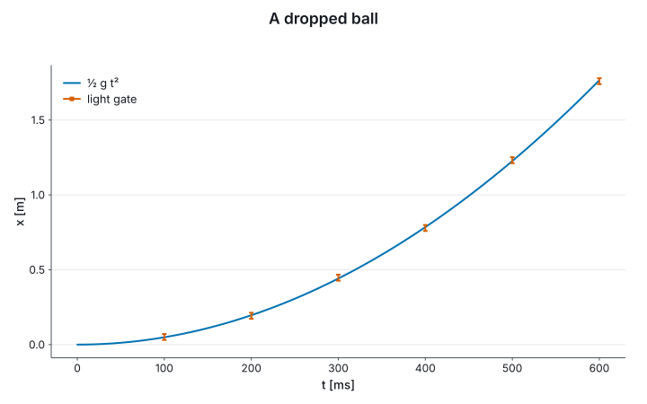

# 1. Start

In a script or a notebook, one line brings the library:

```fsharp
#r "nuget: Marey"
#r "nuget: Marey.Backend.Skia"

open Marey
open Marey.UnitsOfMeasure
```

`Marey` is units, the plotting grammar, fields, simulations, animation, live figures, and SVG,
TikZ and HTML output. `Marey.Backend.Skia` adds PNG and PDF; it is a separate reference because it
brings SkiaSharp's native libraries. In a project, the same two packages:

```
dotnet add package Marey
dotnet add package Marey.Backend.Skia
```

In a [Verso](https://github.com/DataficationSDK/Verso) notebook, the first cell also loads the
extension that displays a figure as a figure. Verso fetches it from nuget.org and asks once before
loading it:

```
#!extension Marey.Verso
```

`open Marey.UnitsOfMeasure` puts the guide in the mode where every axis takes a unit and the
compiler checks it. Without it a chart takes plain numbers and a unit is optional; §2 shows both,
and §14 the C# spelling.

Every `fsharp` block in this guide runs, in order, as one session: the test suite reads the pages,
runs them under `dotnet fsi`, and draws each figure shown under a block from that block. A name
bound in one section is still there in the next.

## A first figure

A ball dropped from rest, timed at six heights by a light gate, against `½ g t²`:

```fsharp output=free-fall
let tGate = [| 0.1<s>; 0.2<s>; 0.3<s>; 0.4<s>; 0.5<s>; 0.6<s> |]
let xGate = [| 0.051<m>; 0.193<m>; 0.447<m>; 0.779<m>; 1.232<m>; 1.759<m> |]
let xErr = Array.create 6 0.02<m>

let g = 9.81<m/s^2>
let tModel = Array.init 61 (fun i -> float i * 0.01<s>)
let xModel = tModel |> Array.map (fun t -> 0.5 * g * t * t)

let fall =
    Chart.line U.second U.metre tModel xModel
    |> Chart.withName "½ g t²"
    |> Chart.addErrorbar U.second U.metre tGate xGate xErr
    |> Chart.withName "light gate"
    |> Chart.withTitle "A dropped ball"
    |> Chart.withLegend LegendBest

fall
```



Nothing set the axes. `U.second` and `U.metre` say what each axis is, and from them and the data
the figure takes its titles, its ticks and its prefixes: the drop lasts 0.6 s, so the time axis
reads `t [ms]` from 0 to 600. The legend comes from the two names, and `LegendBest` puts it in the
corner the data leaves emptiest. `xModel` was never declared a length: `0.5 * g * t * t` is a
`float<m>` because `g` is in m/s² and `t` in seconds, and putting it on a seconds axis would not
compile.

A chart takes any sequence of values: an array, a list, a `ResizeArray`, a `seq`. It reads the
sequence once, when it is built, and keeps its own copy, so changing the array afterwards leaves
the figure as it was.

## The same figure, four ways

A figure is a value. Each output is a renderer applied to it at a size:

```fsharp
let size = Chart.size 720.0 450.0

fall |> Chart.toSvg SvgBackend.render "fall.svg" size
fall |> Chart.withTheme Theme.tikz |> Chart.toFile TikzBackend.render "fall.tex" size
fall |> Chart.toFileBytes SkiaBackend.renderPng "fall.png" size
fall |> Chart.toFileBytes SkiaBackend.renderPdf "fall.pdf" size

let tex = System.IO.File.ReadAllText "fall.tex"
printfn "the TikZ axis titles use siunitx: %b" (tex.Contains @"\qty{")
```

`fall.tex` is a `tikzpicture` for a LaTeX document. Under `Theme.tikz` its text is typeset by the
document, in the document's font, and the units in the axis titles by `siunitx`. The PNG and the
PDF are drawn by Skia, which shapes their text with HarfBuzz. §6 makes a figure for a paper out of
this one.
