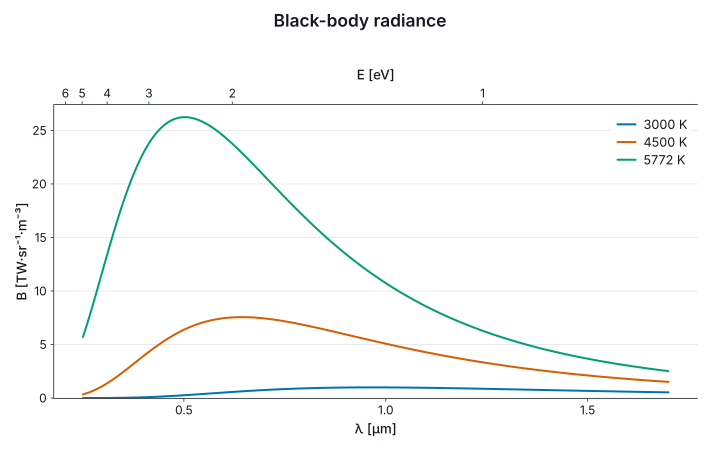

# 2. Units are the labels

A chart takes a *witness* for each axis, `U.second`, `U.metre`, `U.electronvolt`, a value of type
`U<'u>` that carries the measure's dimension, symbol and conversion to SI. The compiler checks the
witness against the data, `float<s>` against `U<s>`, and the figure reads everything else from it.

```fsharp
let unitText u = UnitDisplay.unitText Unicode UnitRegistry.si Prefix.none u

printfn "a newton is %s" (Dim.show (U.dim U.newton))
printfn "a degree Celsius is affine: %b" (U.isAffine U.degreeCelsius)
```

## Prefixes come from the data

The prefix on an axis is chosen from the numbers on it, so the ticks are small numbers and the
title says what they count. §1's drop read `t [ms]`. The same call on a nanometre-scale motion:

```fsharp
let creep = tModel |> Array.map (fun t -> 4.0e-9<m/s> * t)
let creepSvg = Chart.lineIn U.second U.metre tModel creep |> Chart.render SvgBackend.render size

printfn "the creep's axis reads nanometres: %b" (creepSvg.Contains "[nm]")
```

## Composed units name themselves

Witnesses compose as their measures do. A product that has a name in SI is shown by that name; a
product that has none is shown as it was composed, with the prefix on its leading factor:

```fsharp
let force = U.mul U.kilogram U.metrePerSecondSquared
let fieldStrength = U.div U.volt U.metre

printfn "kg · m/s² reads %s" (unitText force)
printfn "V / m reads %s" (unitText fieldStrength)
printfn "in siunitx: %s" (UnitDisplay.unitText Siunitx UnitRegistry.si Prefix.none fieldStrength)
```

The name is looked up from the dimension, not from the spelling, so `kg·m/s²` from any route
reads `N`. A dimension is never factorised: `J/K` and `N·m/K` have the same one, and only the
composition a witness was built from is read back.

An angle is dimensionless in SI, so `rad/s` has the dimension of a hertz, and an angular velocity
is not a frequency: they differ by 2π. A composition containing `rad` is shown as written, and an
axis in `rad·s⁻¹` is titled `ω`:

```fsharp
let angularVelocity = U.div U.radian U.second

printfn "rad / s reads %s, a hertz reads %s" (unitText angularVelocity) (unitText U.hertz)
```

## Values that carry their unit

The witness can travel with the values instead of being handed to every chart. `U.second.Of ts`
is a `Q<s>`, the values and their witness, and a chart over `Q`s takes none. Arithmetic computes
the witness of what it makes, so a quantity derived from others names no unit of its own:

```fsharp
let gCarried = U.metrePerSecondSquared.Of 9.81<m/s^2>
let time = U.second.Of tModel
let drop = 0.5 * gCarried * time * time
let speed = gCarried * time

let carriedSvg =
    Chart.line time drop
    |> Chart.above (Chart.line time speed)
    |> Chart.render SvgBackend.render size

printfn "the drop reads metres, the speed metres per second: %b" (carriedSvg.Contains "[m]" && carriedSvg.Contains "m·s⁻¹")
```

`*` and `/` compose witnesses as the units above do. `+` and `-` take a series in another unit
of the same dimension and read it in the left one's. `Of` on one value makes a `Quantity`, a
constant in that arithmetic, as `gCarried` is. What arithmetic does not reach goes through
`Q.map`, which names the unit of its result: `time |> Q.map U.metre (fun t -> …)`. A `Q` is a
sequence of its values, so it goes wherever one does. Each chart's form with witnesses, for
values that carry none, has the same name with `In`: `Chart.lineIn U.second U.metre ts xs`.

## Units read from text

A unit known only at run time, from a file's header or a netCDF attribute, is read in the syntax
of UDUNITS-2, and composes as `U.mul` and `U.div` would. Its measure is not known to the compiler,
so `U.tryAs` asserts one, checked on the dimension:

```fsharp
let parsed = U.parse "W/(m2 K)"
let asMetres: U<m> option = U.tryAs U.metre (U.parse "km")

printfn "W/(m2 K) reads %s" (unitText parsed)
printfn "km as metres: %b; seconds as metres: %b" asMetres.IsSome (U.tryAs U.metre (U.parse "s")).IsNone
```

## Two errors

Seconds on a metres axis is a type error:

```fsharp-error
// error FS0001: Type mismatch. Expecting a 'float<m> []' but given a 'float<s> []'
Chart.lineIn U.second U.metre tModel tModel
```

Two series that are each correct, but of different dimensions on one axis, are not, and the
compiler cannot see them meet. The figure refuses them when it is drawn, naming both:

```fsharp
let displacementAndTemperature =
    Chart.lineIn U.second U.metre tModel xModel
    |> Chart.addLineIn U.second U.kelvin tModel (tModel |> Array.map (fun t -> 293.0<K> + 2.0<K/s> * t))

let refused =
    try
        displacementAndTemperature |> Chart.render SvgBackend.render size |> ignore
        None
    with e ->
        Some e.Message

printfn "metres and kelvin on one axis are refused: %b" refused.IsSome
```

## Without units

`open Marey` without `Marey.UnitsOfMeasure` is the unit-optional mode. A chart takes plain numbers,
and a unit is a named argument that may be left out. A stated unit gives the axis what a witness
gives it, and the check when two layers meet still runs:

```fsharp optional
open Marey

let ts = Array.init 24 (fun i -> float i * 0.025)
let xs = ts |> Array.map (fun t -> 0.5 * 9.81 * t * t)

let stated = Chart.Line(ts, xs, xUnit = U.second, yUnit = U.metre)
let unstated = Chart.Bar([| 1.0; 2.0; 3.0; 4.0 |], [| 12.4; 19.1; 7.8; 15.0 |]) |> Chart.withYLabel "$M"

let statedSvg = stated |> Chart.render SvgBackend.render (Chart.size 480.0 300.0)
printfn "stated units label the axes: %b" (statedSvg.Contains "x [m]")
```

C# is in this mode, with the witnesses under `Units` (§14).

## A spectrum in two units

Planck's law gives the radiance of a black body per unit wavelength. Written with the constants'
units, the compiler works out that it is a `float<W/(sr m^3)>`, and the witness for the y axis is
composed to match. The top axis reads the same wavelengths as photon energies, `E = hc/λ`, through
the map and its inverse:

```fsharp output=black-body
let planckH = 6.62607015e-34<J s>
let lightSpeed = 2.99792458e8<m/s>
let boltzmann = 1.380649e-23<J/K>
let joulesPerEv = 1.602176634e-19<J/eV>

let radiance (temperature: float<K>) (wavelength: float<m>) =
    let l5 = wavelength * wavelength * wavelength * wavelength * wavelength
    let x = planckH * lightSpeed / (wavelength * boltzmann * temperature)
    2.0 * planckH * lightSpeed * lightSpeed / l5 / (exp x - 1.0) / 1.0<sr>

let spectralRadiance = U.div U.watt (U.mul U.steradian (U.mul U.metre (U.mul U.metre U.metre)))
let wavelengths = Array.init 291 (fun i -> (250.0 + 5.0 * float i) * 1e-9<m>)

let curve (temperature: float<K>) =
    Chart.lineIn U.metre spectralRadiance wavelengths (wavelengths |> Array.map (radiance temperature))
    |> Chart.withName (sprintf "%g K" (float temperature))

let toEnergy (l: float<m>) = planckH * lightSpeed / l / joulesPerEv
let toWavelength (e: float<eV>) = planckH * lightSpeed / (e * joulesPerEv)

let blackBody =
    curve 3000.0<K>
    |> Chart.add (curve 4500.0<K>)
    |> Chart.add (curve 5772.0<K>)
    |> Chart.withTopAxisMapped U.electronvolt toEnergy toWavelength
    |> Chart.withXLabel "λ"
    |> Chart.withYLabel "B"
    |> Chart.withTopAxisLabel "E"
    |> Chart.withLegend LegendBest
    |> Chart.withTitle "Black-body radiance"

blackBody
```



The wavelengths are given in metres and the axis reads µm; the radiance is near 10¹³ W·sr⁻¹·m⁻³
and the axis reads `TW·sr⁻¹·m⁻³`, which is the kW·sr⁻¹·m⁻²·nm⁻¹ a spectroscopist would write. The
energies are chosen as round numbers of eV and placed through the inverse map, so on a reciprocal
they crowd toward short wavelengths. A map that is not monotone over the axis, or whose inverse
does not return each point, is refused when the figure is drawn.
