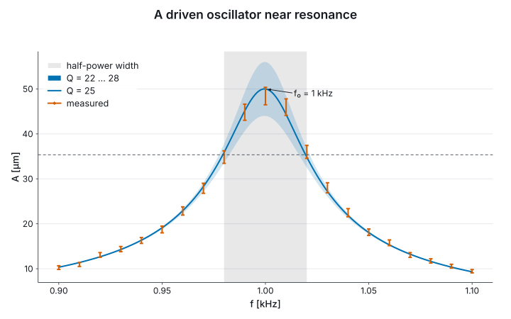

# 3. Marks and layers

Each mark has a constructor that starts a figure, `Chart.line`, and most have an `add` form that
puts another layer on it, `Chart.addLine`. Layers on one panel share its axes, so their domains
are unified and their units must agree.

```fsharp
let levels = [| 1.0<s>; 2.0<s>; 3.0<s>; 4.0<s> |]
let heights = [| 3.0<m>; 7.0<m>; 4.0<m>; 9.0<m> |]
let spread = [| 0.4<m>; 0.6<m>; 0.3<m>; 0.8<m> |]

let marks =
    [ Chart.lineIn U.second U.metre levels heights
      Chart.scatterIn U.second U.metre levels heights
      Chart.areaIn U.second U.metre levels heights
      Chart.barIn U.second U.metre levels heights
      Chart.stepIn U.second U.metre levels heights
      Chart.errorbarIn U.second U.metre levels heights spread
      Chart.ribbonIn U.second U.metre levels (Array.map2 (-) heights spread) (Array.map2 (+) heights spread)
      Chart.segmentIn U.second U.metre levels heights (levels |> Array.map ((+) 0.5<s>)) heights
      Chart.textIn U.second U.metre levels heights [| "a"; "b"; "c"; "d" |]
      Chart.histogramIn U.metre heights
      Chart.densityIn U.metre heights
      Chart.Category.boxplotIn U.metre [| "a"; "b"; "a"; "b" |] heights ]

printfn "%d kinds of mark, each a figure" marks.Length
```

A histogram's bars count rows, so its y axis is a count; a density's is per metre, the reciprocal
of its x axis. `Chart.heatmap` and the field marks of §7 add a colour axis in a third unit.

**Styles and names.** A verb that styles or names applies to the layer added last, so it reads as
a suffix: `withName`, `withColor`, `withDash`, `withMarker`, `withOpacity`. A named layer is in
the legend; an unnamed one is not. A colour set by hand survives `withTheme`, and one left unset is
taken from the theme's palette, so a theme can be applied last.

**Rules, spans and annotations.** `addHLine` and `addVLine` cross the panel at a value of one axis,
`addHSpan` and `addVSpan` shade the band between two, and `addLineThrough` draws a line of a given
slope, in the y unit per x unit. They take the witness of the axis they mark, so a rule in the
wrong unit does not compile, and they do not widen the domain: a rule outside the panel is not
drawn. `annotate` puts text at a point, `withArrow` points at it from the text, and `addPanelText`
writes in the plot's corner by fractions of its size. Annotation text is drawn past the plot's
edge when it has to be, and the figure makes room for it.

## A resonance

A driven oscillator measured at 21 frequencies around its resonance, against the response of a
damped oscillator with quality factor 25. The shaded band is the model for Q between 22 and 28;
the vertical band is the half-power width, `f₀/Q`, and the dashed rule the amplitude at its edges.

```fsharp output=resonance
let f0 = 1000.0<Hz>
let a0 = 2.0e-6<m>

let response (q: float) (f: float<Hz>) =
    let r = f / f0
    a0 / sqrt ((1.0 - r * r) ** 2.0 + (r / q) ** 2.0)

let drive = Array.init 21 (fun i -> 900.0<Hz> + 10.0<Hz> * float i)
let noise, _ = Rng.units 21 (Rng.seeded 7UL)
let amplitude = Array.map2 (fun f u -> response 25.0 f * (1.0 + 0.08 * (u - 0.5))) drive noise
let amplitudeErr = amplitude |> Array.map (fun a -> 0.04 * a)

let sweep = Array.init 201 (fun i -> 900.0<Hz> + 1.0<Hz> * float i)
let peak = response 25.0 f0
let halfWidth = f0 / 25.0 / 2.0

let resonance =
    Chart.vSpan U.hertz (f0 - halfWidth) (f0 + halfWidth)
    |> Chart.withName "half-power width"
    |> Chart.addRibbonIn U.hertz U.metre sweep (sweep |> Array.map (response 22.0)) (sweep |> Array.map (response 28.0))
    |> Chart.withName "Q = 22 … 28"
    |> Chart.withColor Palette.blue
    |> Chart.withOpacity 0.25
    |> Chart.addLineIn U.hertz U.metre sweep (sweep |> Array.map (response 25.0))
    |> Chart.withName "Q = 25"
    |> Chart.withColor Palette.blue
    |> Chart.addErrorbarIn U.hertz U.metre drive amplitude amplitudeErr
    |> Chart.withName "measured"
    |> Chart.withColor Palette.vermillion
    |> Chart.addHLine U.metre (peak / sqrt 2.0)
    |> Chart.annotate U.hertz U.metre f0 peak "f₀ = 1 kHz"
    |> Chart.withTextOffset 40.0<px> -6.0<px>
    |> Chart.withArrow ArrowStraight
    |> Chart.withXLabel "f"
    |> Chart.withYLabel "A"
    |> Chart.withLegend LegendTopLeft
    |> Chart.withTitle "A driven oscillator near resonance"

resonance
```



The model is computed in hertz and metres, and the axes read `f [kHz]` and `A [µm]`. The
annotation points from its text to the peak; the band and the span are in the legend because they
are named, and the rule is not.
