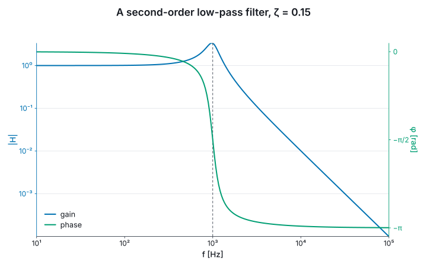

# 4. Axes and scales

An axis is linear unless it is told otherwise, and its domain, ticks, prefix and title come from
the data and the unit. Each can be stated instead.

**Scales.** `withXLog` and `withYLog` put an axis on a base-10 log scale; `withXScaleKind` takes
any of the others: `ScaleKind.Log b`, `ScaleKind.Symlog (b, linthresh)` for data that crosses zero,
`ScaleKind.Power p` and `ScaleKind.Reciprocal`. A scale belongs to the axis, so a layer added
afterwards is drawn on it too. `withXDomain` and `withYDomain` pin a domain.
A log axis that spans three decades or fewer is ticked in plain numbers under an SI prefix; a wider
one is ticked in powers of ten, `10⁻⁸`, and takes no prefix.

**Ticks.** Ticks are chosen on a 1-2-5 ladder unless they are stated. A stated tick is in the
axis's own unit, not its prefix, so it means the same on every figure, and the axis still chooses
its prefix: `withXTicksEvery U.metre 50e-9<m>` on a nanometre axis ticks every 50 nm.
`withXTicksAt` states the values and `withXTicksNamed` the labels too, which is how a band
structure's axis reads `X Γ X`. `withXMinorTicks` takes `MinorAuto`, `MinorOff`, `MinorCount n`
or `MinorEvery step`, and on a log axis the automatic minor ticks fill each decade.

```fsharp
let spectrumAxis =
    Chart.line U.metre U.one [| 400e-9<m>; 700e-9<m> |] [| 0.2; 0.8 |]
    |> Chart.withXDomain 400e-9 700e-9
    |> Chart.withXTicksEvery U.metre 50e-9<m>
    |> Chart.withXMinorTicks (MinorEvery 10e-9)

let spectrumSvg = spectrumAxis |> Chart.render SvgBackend.render size
printfn "ticked every 50 nm: %b" (spectrumSvg.Contains ">450<" && spectrumSvg.Contains "[nm]")
```

**Numbers and titles.** `withXPrefix` writes an axis in a prefix of your choosing, `Prefix.none`
for plain metres. `withXTickFormat` takes `FormatFixed n`, `FormatPercent`, `FormatScientific` or
`TickFormat.custom`. `withXReversed` runs an axis from its high end, for a depth or a magnitude.
`withXLabel` replaces the quantity in the title and keeps the unit, and `withUnitStyle` spells the
unit in `Unicode`, `Ascii`, `Latex` or `Siunitx`. Each verb has a `Y` form.

**A second y axis.** `withRightAxis` takes a figure built as any other and draws its layers
against an axis on the right, as matplotlib's `twinx` does. The two sides must agree on x, which is
checked when they meet. A side with one series draws its numbers and title in that series' colour,
and the legend takes both sides. `withYLog` sets the left side's scale and `withRightYLog` the
right's. A second axis that reads the *same* quantity in other numbers is
`withTopAxisIn` or `withRightAxisIn`, or a map as in §2.

## A Bode plot

The response of a second-order low-pass filter with a cutoff of 1 kHz and damping ratio 0.15: its
gain on a log axis, against frequency over four decades, and its phase on the right, ticked at the
multiples of π/2 it passes through.

```fsharp output=bode
let cutoff = 1000.0<Hz>
let zeta = 0.15
let bodeFrequencies = Array.init 241 (fun i -> 10.0<Hz> * 10.0 ** (float i / 60.0))

let gain (f: float<Hz>) =
    let r = f / cutoff
    1.0 / sqrt ((1.0 - r * r) ** 2.0 + (2.0 * zeta * r) ** 2.0)

let phase (f: float<Hz>) =
    let r = f / cutoff
    -(atan2 (2.0 * zeta * r) (1.0 - r * r)) * 1.0<rad>

let halfTurn = System.Math.PI * 1.0<rad>

let phaseSide =
    Chart.line U.hertz U.radian bodeFrequencies (bodeFrequencies |> Array.map phase)
    |> Chart.withName "phase"
    |> Chart.withXLog
    |> Chart.withYTicksNamed U.radian [| 0.0<rad>, "0"; -halfTurn / 2.0, "−π/2"; -halfTurn, "−π" |]

let bode =
    Chart.line U.hertz U.one bodeFrequencies (bodeFrequencies |> Array.map gain)
    |> Chart.withName "gain"
    |> Chart.addVLine U.hertz cutoff
    |> Chart.withXLog
    |> Chart.withYLog
    |> Chart.withRightAxis phaseSide
    |> Chart.withXLabel "f"
    |> Chart.withYLabel "|H|"
    |> Chart.withRightYLabel "φ"
    |> Chart.withLegend LegendBottomLeft
    |> Chart.withTitle "A second-order low-pass filter, ζ = 0.15"

bode
```



The frequency axis spans four decades, so it is ticked in powers of ten, `10¹` to `10⁵`.
The gain peaks at `1/(2ζ)` near the cutoff and falls as `f⁻²` past it, two decades of gain per
decade of frequency on the log-log axes. Each side's numbers are in its series' colour.
