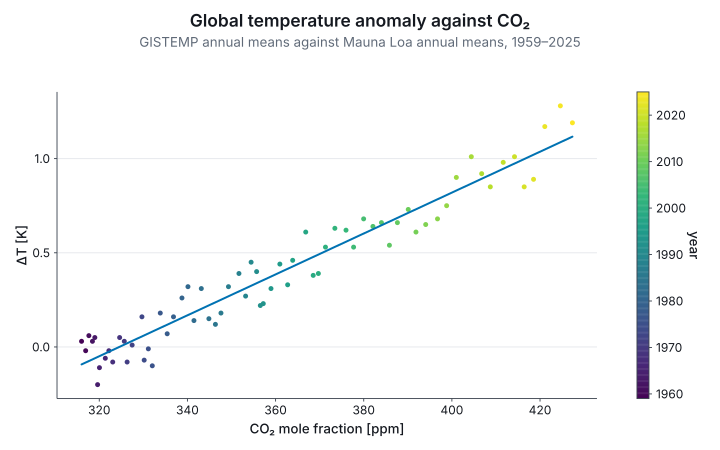

# 5. Data in a table

## Two real records

The repository carries two annual records in `examples/data`: NOAA's mean CO₂ mole fraction at
Mauna Loa since 1959, and NASA's GISTEMP global mean temperature anomaly since 1880. Each is a CSV
with comment lines; joined on the year, they are one table:

```fsharp
let readRecord (path: string) =
    System.IO.File.ReadAllLines path
    |> Array.filter (fun l -> l <> "" && System.Char.IsDigit l.[0])
    |> Array.map (fun l -> l.Split ',' |> Array.map (fun v -> System.Double.Parse(v, System.Globalization.CultureInfo.InvariantCulture)))

type ClimateYear =
    { Year: int
      Co2: float
      Anomaly: float<K> }

let co2ByYear =
    readRecord "examples/data/co2-mauna-loa.csv" |> Array.map (fun r -> int r.[0], r.[1]) |> Map.ofArray

let climate =
    readRecord "examples/data/gistemp-annual.csv"
    |> Array.choose (fun r ->
        let year = int r.[0]

        co2ByYear
        |> Map.tryFind year
        |> Option.map (fun co2 ->
            { Year = year
              Co2 = co2
              Anomaly = r.[1] * 1.0<K> }))

printfn "%d years, %d to %d" climate.Length climate.[0].Year (Array.last climate).Year
```

A CO₂ mole fraction in ppm is dimensionless, micromoles per mole, so there is no unit to derive
its axis title from and nothing for the compiler to check. It is a `float` on a `U.one` axis, and
the title is written by hand. An anomaly is a temperature difference, in kelvin.

## Statistics are typed

Each statistic is a function in `Stat` over typed arrays, and its result carries the units: a
least-squares slope of kelvin against ppm is in kelvin per ppm, which is kelvin. A bootstrap
interval is in the statistic's unit, and carries its seed, so the interval can be cited.

```fsharp
let co2s = climate |> Array.map (fun r -> r.Co2)
let anomalies = climate |> Array.map (fun r -> r.Anomaly)

let warming = Stat.regression U.one U.kelvin co2s anomalies
let perHundredPpm: float<K> = 100.0 * warming.Slope

let slopeOf (xs: float[]) (ys: float<K>[]) = (Stat.regression U.one U.kelvin xs ys).Slope
let slopeInterval = Stat.bootstrapPairs 2026UL slopeOf co2s anomalies

printfn "%.2f K per 100 ppm, 95%% from %.2f to %.2f, seed %d"
    (float perHundredPpm) (100.0 * float slopeInterval.Lo) (100.0 * float slopeInterval.Hi) slopeInterval.Seed
```

The rest are `Stat.histogram` and `binWith`, `density`, `ecdf`, `summary` (the five numbers a box
plot is drawn from), `quantile`, `loess` with R's defaults, `hexbin`, and `bootstrap` for a single
sample. Each has a `Chart` form that draws it, and each drops non-finite input and says how much.

## Channels beyond x and y

A layer can carry three more channels. `colorByKey` and `shapeByKey` take a category, one colour or
marker per level, named in the legend; shape survives greyscale printing and colour blindness, so
the two are worth using together. `colorBy` and `sizeBy` take a quantity, with its witness: a
colour channel in kelvin gets a colorbar titled `T [K]`, and a size channel a key of three marks.
`Chart.Category` puts categories on the x axis, as bands, with `bar`, `scatter`, `count`,
`boxplot` and `violin`.

## The `plot` block

When the data is a table, `plot` says in one place what each column means: positions, colour,
shape and size, a statistic, the marks, small multiples. Each quantity takes its witness beside
its accessor, checked against the column's type; a category takes none.

```fsharp
let byPeriod =
    plot climate {
        x U.one (fun r -> r.Co2)
        y U.kelvin (fun r -> r.Anomaly)
        facetWrap (fun r -> if r.Year < 1990 then "1959–1989" else "1990–2025")
        fit
    }

printfn "panels: %d, sharing their axes" byPeriod.Panels.Length
```

A block with no `layer` is a scatter, and every layer of a block is one series, so `layer GeomLine`
beside `layer GeomPoint` is a line with markers. `histogram`, `density` and `ecdf` take `x` alone
and produce y. `facetWrap` draws one panel per level over shared axes, so a difference between
panels is a difference in the data; anything that must agree across them, the colours, a colorbar,
a histogram's bins, is computed before the split. The block returns a `Figure`, and every verb of
the earlier sections applies to it.

## Warming against CO₂

Each year's temperature anomaly against that year's CO₂, coloured by the year on a colorbar, with
the least-squares line:

```fsharp output=warming-co2
let warmingFigure =
    plot climate {
        x U.one (fun r -> r.Co2)
        y U.kelvin (fun r -> r.Anomaly)
        colorBy U.one (fun r -> float r.Year)
        colorLabel "year"
        fit
    }
    |> Chart.withXLabel "CO₂ mole fraction [ppm]"
    |> Chart.withYLabel "ΔT"
    |> Chart.withTitle "Global temperature anomaly against CO₂"
    |> Chart.withSubtitle "GISTEMP annual means against Mauna Loa annual means, 1959–2025"

warmingFigure
```



The line is the regression of the statistics above, about 1.1 K per 100 ppm over these 67 years.
The x title, `[ppm]` included, is written by hand, because the data carries no unit to derive it
from.
