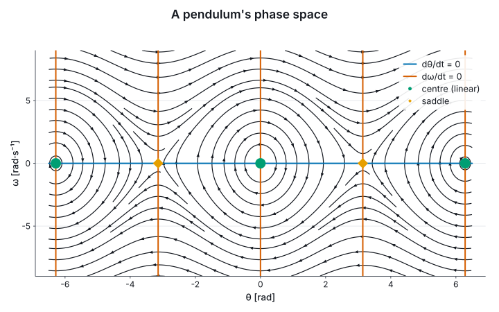

# 7. Fields

`Marey.Fields` draws quantities defined over a plane: a potential, an electric field, the flow of
a dynamical system. A field given as a function is sampled once onto a grid, at a resolution you
state, and every mark reads the grid; `ScalarGrid.create` and `VectorGrid.create` take data that is
already gridded. A sample that is not finite, as a potential is at its charge, is kept, counted and
never drawn.

```fsharp
let dipolePotential (p: Vec2<m>) =
    let plus = Vec2.norm { X = p.X - 0.6<m>; Y = p.Y + 0.1<m> }
    let minus = Vec2.norm { X = p.X + 0.6<m>; Y = p.Y - 0.1<m> }
    (log (float minus) - log (float plus)) * 1.0<V>

let fieldXs = Grid.linear -1.8<m> 1.8<m> 108
let fieldYs = Grid.linear -1.2<m> 1.2<m> 72
let phi = Field.sampleScalar fieldXs fieldYs dipolePotential
```

## Derivatives in the units the types work out

`Field.grad`, `div`, `curl`, `laplacian` and `jacobian` are differences on the grid, exact for a
quadratic and second order otherwise, and their units are the types'. The gradient of a potential
in volts is in V/m, and the divergence of that in V/m²:

```fsharp
let electricField =
    let g = Field.grad phi
    { g with U = Array.map (~-) g.U; W = Array.map (~-) g.W }

let chargeDensityOverEpsilon: ScalarGrid<m, m, V/m^2> = Field.div electricField

printfn "E is sampled at %d × %d nodes" electricField.Xs.Length electricField.Ys.Length
```

## The marks

A scalar field draws as `Field.heatmap`, `Field.contours` (at the levels its range would be ticked
at, or `contoursAt` stated ones) and `Field.bands`, each with a colorbar in the field's unit. A
vector field draws as `Field.quiver`, an arrow per node with a key saying what one length means;
`Field.streamlines`, evenly spaced on the page, the same lines for the same field; and `Field.lic`,
a line-integral convolution that shows the flow at every pixel as a seeded raster. Each is computed
against the panel's final scales, so the marks line up with one another, on a log axis as on a
linear one. `Chart.overlay` puts one figure's layers over another's panel.

## A dipole

The potential of two opposite line charges on a diverging ramp, its equipotentials, and the
field's lines over them. The colour range is stated, because a few nodes beside each charge would
otherwise set it; the aspect is equal, because a field is read as a picture of the plane:

```fsharp output=dipole size=720x520
let dipole =
    Field.heatmapWith Theme.modern.Diverging true U.metre U.metre U.volt phi
    |> Chart.withColorDomain U.volt -2.0<V> 2.0<V>
    |> Chart.withColorLabel "φ"
    |> Chart.overlay (Field.contoursAt [| -1.5<V>; -1.0<V>; -0.5<V>; 0.0<V>; 0.5<V>; 1.0<V>; 1.5<V> |] U.metre U.metre phi)
    |> Chart.overlay (Field.streamlinesWith 18.0<px> U.metre U.metre electricField)
    |> Chart.withYLabel "y"
    |> Chart.withEqualAspect
    |> Chart.withTitle "Two line charges"

dipole
```


## A phase space

A pendulum's state is an angle and an angular velocity, two units, so a field with one unit on
both axes cannot hold it. A `Flow<rad, rad/s, s>` can. Its divergence is in s⁻¹, and is zero,
because phase-space area is conserved. `curl` and `laplacian` need one unit on both axes, so over a
phase space they do not compile: ∂ω̇/∂θ and ∂θ̇/∂ω are in different units and their difference does
not exist.

```fsharp-error
Field.curl swingGrid
```

`Phase.fixedPoints` finds where the flow vanishes and classifies each point by its linearisation,
with its eigenvalues in `1/'t`; `Phase.portrait` draws the streamlines, both nullclines and the
fixed points marked by kind:

```fsharp output=pendulum-phase
let swing: Flow<rad, rad/s, s> = fun th om -> struct (om, -9.81<1/s^2> * sin (float th) * 1.0<rad>)

let swingGrid =
    Field.sampleFlow (Grid.linear -6.5<rad> 6.5<rad> 105) (Grid.linear -9.0<rad/s> 9.0<rad/s> 73) swing

let liouville: ScalarGrid<rad, rad/s, 1/s> = Field.div swingGrid

for p in Phase.fixedPoints swingGrid do
    printfn "%s" (FixedPoint.describe U.radian angularVelocity U.second p)

Phase.portrait U.radian angularVelocity swingGrid
|> Chart.withTitle "A pendulum's phase space"
```



The session prints a centre at 0 and ±2π and a saddle at ±π, with eigenvalues ±3.13i s⁻¹ and
±3.13 s⁻¹: rates, so in s⁻¹ rather than Hz. A centre is a judgement, since only the nonlinear terms
tell it from a weak focus, and is called one when the real part is under a thousandth of the
imaginary; `Phase.fixedPointsWith` states another tolerance. A field that changes in time is an
animation of figures, and §9 films one.
