# 9. Animation

An animation is a pure function of time, `Anim<'a>`: a duration and the value at each instant.
Nothing is stepped, so frame 900 costs what frame 1 costs, frames can be asked for in any order,
and a timeline can be scrubbed.

```fsharp
let climb = Anim.tween 2.0<s> 0.0<m> 100.0<m>

printfn "at 1 s: %.1f m; at 90%%: %.1f m; past the end: %.1f m"
    (float (climb |> Anim.at 1.0<s>)) (float (climb |> Anim.atFraction 0.9)) (float (climb |> Anim.at 9.0<s>))
```

`Anim.tween` interpolates anything Core can: a `float<'u>`, a `Vec2`, a `Rect`, an affine
transform, a `Color` through Oklab, so a fade from blue to yellow does not pass through grey.

## Composing

`Anim.map2` runs two animations side by side, for the longer of their durations, the shorter
holding its last value; `Anim.andThen` runs one after the other, for the sum. `Anim.map` turns the
values into something else, `Anim.stretch` scales the duration, and `Anim.ease` reparameterises
the clock with one of the twenty-eight easings in `Ease`: quad, cubic, quart, sine, expo, circ,
back, elastic and bounce, each in, out and in-out, and linear.

```fsharp
let upAndDown = Anim.andThen climb (Anim.tween 1.0<s> 100.0<m> 0.0<m>)
let overshoot = Anim.tween 1.0<s> 0.0 1.0 |> Anim.ease Ease.backOut

printfn "up then down lasts %.1f s" (float (Anim.duration upAndDown))
printfn "backOut overshoots to %.3f and lands on %.3f" (overshoot |> Anim.atFraction 0.35) (overshoot |> Anim.atFraction 1.0)
```

`Anim.at` clamps its time to the duration, which is what makes the hold and `andThen` well
defined; the eased fraction is not clamped, which is what lets `backOut` overshoot. `Morph.anim`
turns one path into another, resampled by arc length so the change runs at an even speed.

## Animating a figure

An animation of figures becomes a film with `Film.ofFigures samples extent`. Laid out frame by
frame, a panel would breathe: a y axis climbing past 100 gains a digit on every label, the gutter
widens, and the plot moves while the data was meant to. So a film is laid out once, over the union
of its sampled states, and every frame is drawn inside that layout. The same union holds each
axis's prefix, so a zoom across a decade does not step `mm` to `µm` mid-shot, and each colour
scale, so a field that grows is seen to grow.

## The Bode plot, sweeping its damping

§4's filter, with its damping ratio eased from 0.05 to 1 over three seconds. The resonant peak
falls and broadens, the phase's step softens, and the panel, the ticks' room and both titles stay
where they are:

```fsharp output=bode-sweep frames=20
let bodeFor (damping: float) =
    let gainAt (f: float<Hz>) =
        let r = f / cutoff
        1.0 / sqrt ((1.0 - r * r) ** 2.0 + (2.0 * damping * r) ** 2.0)

    let phaseAt (f: float<Hz>) =
        let r = f / cutoff
        -(atan2 (2.0 * damping * r) (1.0 - r * r)) * 1.0<rad>

    Chart.lineIn U.hertz U.one bodeFrequencies (bodeFrequencies |> Array.map gainAt)
    |> Chart.withName "gain"
    |> Chart.addVLine U.hertz cutoff
    |> Chart.withXLog
    |> Chart.withYLog
    |> Chart.withYDomain 1e-4 20.0
    |> Chart.withRightAxis (
        Chart.lineIn U.hertz U.radian bodeFrequencies (bodeFrequencies |> Array.map phaseAt)
        |> Chart.withName "phase"
        |> Chart.withXLog
        |> Chart.withYTicksNamed U.radian [| 0.0<rad>, "0"; -halfTurn / 2.0, "−π/2"; -halfTurn, "−π" |]
    )
    |> Chart.withXLabel "f"
    |> Chart.withYLabel "|H|"
    |> Chart.withRightYLabel "φ"
    |> Chart.withLegend LegendBottomLeft
    |> Chart.withTitle (sprintf "A second-order low-pass filter, ζ = %.2f" damping)

Anim.tween 3.0<s> 0.05 1.0
|> Anim.ease Ease.sineInOut
|> Anim.map bodeFor
```



The y domain is stated, because the peak at ζ = 0.05 is ten times the gain at ζ = 1 and a domain
that followed each frame would rescale the axis under the curve. The title is the one thing that
changes with the data.
