# 10. The storyboard

An animation is usually a sequence: something arrives, it changes, an axis zooms, one point is
picked out. The `scene` block does the arithmetic of which step is running and how far through it.

```fsharp
open Marey.Storyboard

let resonanceStory =
    scene {
        let! points = draw (Chart.scatterIn U.hertz U.metre drive amplitude) |> over 1.0<s>
        do! wait 0.4<s>

        do!
            parallel'
                [ points |> morphTo (Chart.scatterIn U.hertz U.metre drive (drive |> Array.map (response 25.0))) |> over 1.2<s>
                  points |> zoomToX (960.0, 1040.0) |> over 1.2<s> ]

        do! highlight points.[10] |> over 0.6<s>
        do! wait 0.6<s>
    }

printfn "the story runs for %.1f s" (float (Storyboard.duration resonanceStory))
```

The block is a value: nothing is measured or drawn until it is filmed.

**What `let!` binds** is a handle: a name for something on stage, and the time it took to arrive,
which is the default duration for every verb applied to it later. `points` is used three times
after it is bound, each time to mean the scatter already drawn.

**The verbs.** `draw fig` puts a figure on stage and reveals it; `over d` says how long a step
takes, and `wait d` holds. `parallel'` runs branches together, for the longest of them. `morphTo`
interpolates the data into another figure's, so every instant is a real figure whose ticks and
prefix come from the numbers on screen, and two series in kilometres and metres morph by
converting. `zoomToX` and `zoomToY` animate a domain, `highlight h.[i]` grows one mark and rings it,
and `fadeIn` fades a named part in.

**`points.[10]`** names the eleventh datum. A scatter of 100 000 points is one node, so naming one
splits it into the marks before, the mark, and the marks after; nothing is split until something is
named. When rows have names of their own, `key` in the `plot` block keys each mark by its row's
name, so a morph between two tables pairs rows by name: the rows that stayed hold still, a removed
row fades out where it was, and `points.["S6"]` names a row by its key.

## Filmed

`Film.ofStory samples extent story` samples the story, lays it out once over everything it saw,
and holds every frame inside that layout, as §9's films are:

```fsharp output=resonance-story frames=26
Film.ofStory 32 (Chart.size 720.0 450.0) resonanceStory
```


An animation of figures is a film too, with no storyboard: the double pendulum of §8, drawn at
each instant of its trajectory.

```fsharp output=double-pendulum-swing size=480x480 frames=40
let drawArms (a: Arms) =
    let x1, y1 = armLength * sin (float a.T1), -armLength * cos (float a.T1)
    let x2, y2 = x1 + armLength * sin (float a.T2), y1 - armLength * cos (float a.T2)

    Chart.lineIn U.metre U.metre [| 0.0<m>; x1; x2 |] [| 0.0<m>; y1; y2 |]
    |> Chart.addScatterIn U.metre U.metre [| x1; x2 |] [| y1; y2 |]
    |> Chart.withStyle (Geom.withMarkerSize 12.0<px>)
    |> Chart.withXDomain -2.2 2.2
    |> Chart.withYDomain -2.2 2.2
    |> Chart.withXLabel "x"
    |> Chart.withYLabel "y"
    |> Chart.withEqualAspect
    |> Chart.withTitle "A double pendulum"

let swingFilm = Film.ofFigures 40 (Chart.size 480.0 480.0) (Anim.map drawArms (Sim.trajectory 0.25<s> 4.0<s> doublePendulum))
swingFilm
```



## Frames and video

`Frames.write` renders a film's frames, on every core, to numbered files at a frame rate, and
reports any file of the same pattern it did not write: a frame left from a longer render would
otherwise be read on into the video. `Marey.Tools.Video` encodes the frames with `ffmpeg`, found on
`PATH`; a missing `ffmpeg` is an outcome that says what to install, and the frames stay on disk.
`Video.args` is the command as a value, and `Video.inspect` reads the result back with `ffprobe`.

```fsharp
#r "nuget: Marey.Tools.Video"

let swingFrames =
    swingFilm |> Frames.write FramePass.Concurrent SkiaBackend.renderPng (FrameTarget.into "swing" ".png") 20.0

match Video.mux MuxOptions.Default swingFrames "swing.mp4" with
| MuxRan run when run.Succeeded ->
    match Video.inspect run.Output with
    | Inspected info -> printfn "swing.mp4: %s, %d × %d, %d frames at %g fps" info.Codec info.Width info.Height info.FrameCount info.Fps
    | other -> printfn "%A" other
| MuxUnavailable why -> printfn "%s" why
| other -> printfn "%A" other
```

## Typeset text

`Marey.Tools.Tex` sets TeX with `latex`, turns it into outlines with `dvisvgm`, and puts the
outlines in the scene in place of the text, so every backend draws the formula with the code it
already has. Any text run can carry a TeX form beside its plain one, and the axis titles under
`Theme.tikz` carry theirs. Without TeX on the machine, the plain text is drawn and the call says
so; a formula TeX rejects keeps its text, alone. `TexCache` keeps the outlines across the frames
of a film.

```fsharp
#r "nuget: Marey.Tools.Tex"

let equationOfMotion: Node =
    Text
        { Text = "θ'' = −(g/l) sin θ"
          Tex = Some @"$\ddot\theta = -\frac{g}{l}\sin\theta$"
          At = { X = 0.5<nd>; Y = 0.5<nd> }
          Font = { Family = Theme.Serif; Size = 20.0<pt>; Weight = 400; Italic = false }
          Paint = Solid(Color.rgb 0.1 0.1 0.12)
          Anchor = AnchorMiddle
          Baseline = BaselineAlphabetic
          Rotation = 0.0<rad> }

let typeset, typesetNote = Typeset.sceneOrPlain TexOptions.Default (Chart.size 360.0 100.0) equationOfMotion

printfn "%s" typesetNote
```
