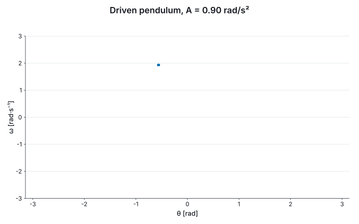

# 12. Interaction

`interact` puts controls on a figure. In a notebook the cell becomes a live figure: the reader moves
a slider, the kernel runs the view again with the new value, and the figure that comes back is
drawn by the same code as every other figure in this guide.

| | The view receives | The label reads |
|---|---|---|
| `Control.slider u label lo hi init` | `float<'u>` | the value in `'u`, under one prefix chosen for the whole range |
| `Control.sliderBy u label lo hi step init` | `float<'u>` | as above, in steps |
| `Control.select label [ name, value; … ] init` | the chosen value | its name |
| `Control.checkbox label init` | `bool` | `on` or `off` |
| `Control.time label lo hi` | `float<s>` | a range with a play button, for a trajectory |

A control is typed: a slider over rad/s² hands the view a `float<rad/s^2>`, and its label is written
in that unit. The block is applicative, `let! … and! … return`, so the set of controls is known
before the view runs and cannot depend on a control's value.

## A driven pendulum on the way to chaos

A damped pendulum driven at two thirds of its natural frequency. Its state is sampled once per drive
period, a stroboscopic Poincaré section, after the transient has died. At a small drive the section
is a point, a periodic orbit; as the drive grows the orbit doubles and the section fills out into a
strange attractor, with windows where order returns. One slider sets the drive's amplitude:

```fsharp output=driven-pendulum-live
let naturalRate = 1.0<1/s^2>
let pendulumDamping = 0.5</s>
let driveFrequency = 2.0 / 3.0 * 1.0<rad/s>
let drivePeriod = 2.0 * System.Math.PI * 1.0<rad> / driveFrequency

let drivenPendulum (amplitude: float<rad/s^2>) : Flow2T<rad, rad/s, s> =
    fun t th om ->
        struct (om, -naturalRate * sin (float th) * 1.0<rad> - pendulumDamping * om + amplitude * cos (float (driveFrequency * t)))

let strobe (amplitude: float<rad/s^2>) =
    Sim.ofStep (drivePeriod / 400.0) (Ode.rk4 (drivenPendulum amplitude)) (struct (0.2<rad>, 0.0<rad/s>))
    |> Sim.trajectory drivePeriod (240.0 * drivePeriod)
    |> Poincare.stroboscopic drivePeriod
    |> Array.skip 40

let sectionAt (amplitude: float<rad/s^2>) =
    let points = strobe amplitude

    Chart.scatterIn U.radian angularVelocity
        (points |> Array.map (fun p -> let struct (th, _) = p.State in wrapAngle th))
        (points |> Array.map (fun p -> let struct (_, om) = p.State in om))
    |> Chart.withXDomain (-System.Math.PI) System.Math.PI
    |> Chart.withYDomain -3.0 3.0
    |> Chart.withTitle (sprintf "Driven pendulum, A = %.2f rad/s²" (float amplitude))

let angularAcceleration = U.div U.radian (U.mul U.second U.second)

let explorer =
    interact {
        let! amplitude = Control.slider angularAcceleration "A" 0.9<rad/s^2> 1.5<rad/s^2> 0.9<rad/s^2>
        return sectionAt amplitude
    }

explorer
```



In Verso, `explorer` as a cell's value is the live figure: drag the slider and the section is
recomputed for that drive. On the figure, a drag zooms onto a box, shift-drag pans, a double-click
returns to the view's own domains, and the pointer's position is read out in the axes' units. The
page formats no number; every label and reading is written by the kernel.

## A live figure is a value

What the notebook does is a fold over the reader's messages, and it runs without a notebook. A
message is `Set (control, value)`, a zoom, a pan, a hover or a resize, and `Live.step` is total: a
message it cannot use returns the state it was given, because a page in someone's browser sent it.

```fsharp
let atStart = Live.init explorer
let pushed = Live.step explorer atStart (Set(0, 1.2))

printfn "%s" (String.concat ", " (Live.shown explorer pushed))
printfn "the same message gives the same state: %b" (Live.step explorer atStart (Set(0, 1.2)) = pushed)
printfn "a message for no control changes nothing: %b" (obj.ReferenceEquals(Live.step explorer atStart (Set(7, 1.0)), atStart))
```

The figure is laid out once, against the states its controls reach at their extremes, so the plot
area holds still while the reader drags.

## Recorded

Because the step is pure, a session is its messages. `Live.recorder` keeps what a reader did, with
the page's own times, `LiveLog` writes it as JSON and reads it back exactly, and `Live.film` replays
it as a film. Here, a session that walks the drive from 0.9 to 1.5 rad/s²:

```fsharp output=driven-pendulum-session frames=26
let session = Recording.ofEvents [| for i in 0..12 -> 0.5<s> * float i, Set(0, 0.9 + 0.05 * float i) |]

printfn "the log reads back exactly: %b" (LiveLog.ofJson (LiveLog.toJson session) = Ok session)

Live.film explorer (Live.record explorer session)
```


