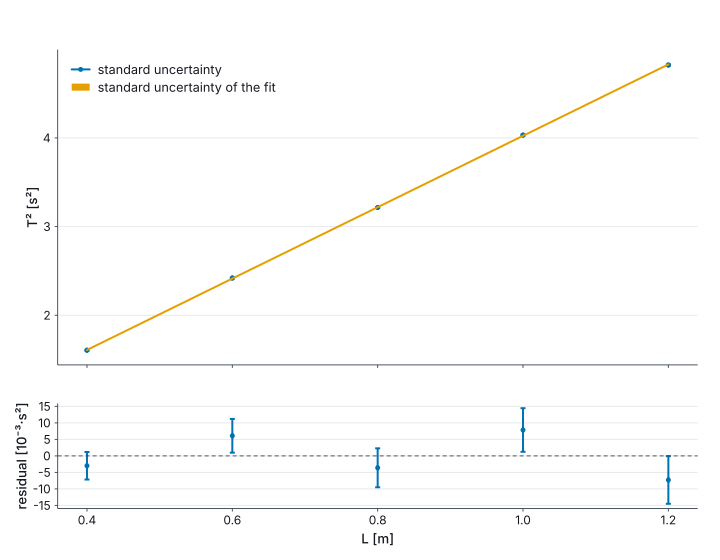
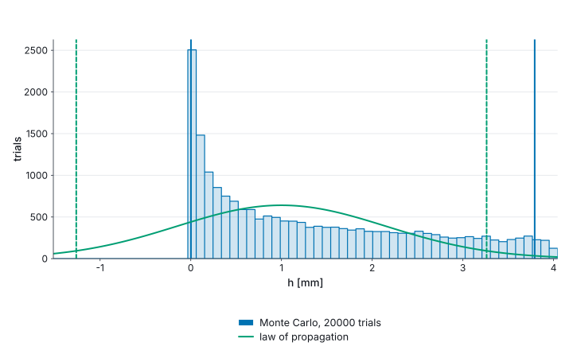

# 16. Measurement uncertainty

`Marey.Uncertainty` carries a measured value's standard uncertainty through the arithmetic, as
the GUM (JCGM 100) evaluates it, and keeps where it came from. An `Uncertain<'u>` is an estimate,
the witness of its unit, and the contribution of each input it rests on, so a result knows its
combined standard uncertainty, which input dominates it and its degrees of freedom. A shared input
is one input wherever it is used: `x - x` is exactly zero, and a calibration two readings share
drops out of their difference.

This section follows one lab, g from a pendulum.

## Inputs as a lab names them

A length read off a tape marked in millimetres, five stopwatch timings of ten swings, and the
stopwatch's calibration certificate:

```fsharp
let pendulumLength = Uncertain.resolution "Length" U.metre 0.800<m> 1e-3<m>
let tenSwings = Uncertain.ofReadings "Ten periods" U.second [ 17.951<s>; 17.901<s>; 17.971<s>; 17.921<s>; 17.911<s> ]
let stopwatch = Uncertain.certificate "Stopwatch calibration" U.second 0.0<s> 0.02<s> 2.0

let swingPeriod = (tenSwings + stopwatch) / 10.0
let gPendulum = 4.0 * System.Math.PI ** 2.0 * pendulumLength / (swingPeriod * swingPeriod)

printfn "%s" (Uncertain.report gPendulum)
printfn "%s" (Budget.text (Uncertain.budget gPendulum))
```

`resolution` takes the step an instrument shows, and a reading anywhere within it has the
standard uncertainty step/√12. `ofReadings` is a type A evaluation: the mean, s/√n, and n − 1
degrees of freedom. `certificate` takes the expanded uncertainty a certificate states and its
coverage factor. The session prints:

```text
9.823(18) m·s⁻²
Input                  Value            ν     Type  Contribution  Share
Ten periods            17.931(13) s     4     A     0.014 m·s⁻²   60.6 %
Stopwatch calibration  0.000(10) s      ∞     B     0.011 m·s⁻²   35.7 %
Length                 0.80000(29) m    ∞     B     0.0035 m·s⁻²  3.7 %
Combined               9.823(18) m·s⁻²  10.9        0.018 m·s⁻²
```

The report is the GUM's concise form, the uncertainty to two digits and the estimate rounded to
the same place (7.2.6), and the unit is the one the arithmetic composed. The budget is where an
experiment is improved. The scatter of the timings is three fifths of the variance, so a longer
series pays. The tape barely matters. Timing ten swings has already divided the reaction time and
the calibration by ten.

`Uncertain.standard` takes a standard uncertainty as stated, `rectangular` and `triangular` a
half-width, and `9.81<m/s^2> +- 0.02<m/s^2>` writes an unnamed input where it is used.

## Expanded, compared, written for a paper

An expanded uncertainty reads its coverage factor from Student's t at the effective degrees of
freedom (Welch–Satterthwaite, 10.9 here, taken down to 10 as the GUM does):

```fsharp
let gExpanded = Uncertain.expanded 0.95 gPendulum
printfn "%s" (Uncertain.reportExpanded gExpanded)

let fromStandardGravity = gPendulum - Constants.Quantities.standardGravity
printfn "%s" (Uncertain.reportExpanded (Uncertain.expanded 0.95 fromStandardGravity))

printfn "%s" (Uncertain.reportWith { Uncertain.reportFormat with Style = Siunitx } gPendulum)
```

`(9.823 ± 0.041) m·s⁻² (k = 2.23, 95 %, ν = 10)`. The difference from standard gravity,
`(0.016 ± 0.041) m·s⁻²`, is well inside its interval. `Constants.Quantities.standardGravity` is
exact, and an `Uncertain` takes a `Quantity` or a `float<'u>` in its arithmetic as it takes
another `Uncertain`. For a paper, `Siunitx` writes `\qty{9.823(18)}{\metre\per\second\squared}`,
and `Budget.latex` the budget as a `tabular`.

The measured physical constants carry their uncertainties as `Uncertain.Constants`:
`Constants.Quantities.e / Uncertain.Constants.me` is 1.75882000838(54) × 10¹¹ C·kg⁻¹, to compare
an e/m experiment with. They are correlated as CODATA's are, through the fine-structure constant
and the relative atomic masses they rest on, so `Uncertain.Constants.mp / Uncertain.Constants.me`
is known far better than either mass.

## A line through T² against L

One length gives g through one period. Five lengths give it through the slope of T² against L,
4π²/g, and the intercept tells whether the lengths were measured to the right point. The same
stopwatch times every length, so it is one input in all five periods; the reaction time is new at
each timing and sits in each series' own scatter.

```fsharp
let lengthsMeasured = [| 0.400<m>; 0.600<m>; 0.800<m>; 1.000<m>; 1.200<m> |]

let timingsOfTen =
    [| [ 12.692<s>; 12.642<s>; 12.712<s>; 12.662<s>; 12.652<s> ]
       [ 15.576<s>; 15.526<s>; 15.596<s>; 15.546<s>; 15.536<s> ]
       [ 17.951<s>; 17.901<s>; 17.971<s>; 17.921<s>; 17.911<s> ]
       [ 20.099<s>; 20.049<s>; 20.119<s>; 20.069<s>; 20.059<s> ]
       [ 21.978<s>; 21.928<s>; 21.998<s>; 21.948<s>; 21.938<s> ] |]

let lengthsUncertain =
    lengthsMeasured |> Array.mapi (fun i l -> Uncertain.resolution (sprintf "Length %d" (i + 1)) U.metre l 1e-3<m>)

let periodsSquared =
    timingsOfTen
    |> Array.mapi (fun i timings ->
        let t = (Uncertain.ofReadings (sprintf "Ten periods %d" (i + 1)) U.second timings + stopwatch) / 10.0
        t * t)

let pendulumLine = Fit.line lengthsUncertain periodsSquared
let gFromSlope = 4.0 * System.Math.PI ** 2.0 / pendulumLine.Slope |> Uncertain.convert U.metrePerSecondSquared

printfn "slope %s, intercept %s, χ²/ν = %.2f" (Uncertain.report pendulumLine.Slope) (Uncertain.report pendulumLine.Intercept) pendulumLine.ReducedChiSquared
printfn "g = %s" (Uncertain.report gFromSlope)
```

The slope is `4.0251(77) s²·m⁻¹` and the intercept `-0.0012(57) s²`, zero within its uncertainty,
so the lengths ran to the bob's centre. χ²/ν = 1.52 on three degrees of freedom says the points
scatter about the line as their uncertainties say they should. g = `9.808(19) m·s⁻²`.

`Fit.line` weights each point by its uncertainty, and with uncertain lengths too by their effective
variance. Its slope and intercept are `Uncertain` values whose contributions point back to every
input of every point, so g's budget names them: the two end lengths' timings carry most of it, as
the ends of a line hold its slope, and the stopwatch is one row, not five. 4π²/slope composes its
unit as s⁻²·m; `Uncertain.convert` restates it in the witness one would write.

A line with its band, over the residuals with their error bars:

```fsharp output=pendulum-fit size=720x560
let pendulumResiduals =
    Array.map2 (fun (l: Uncertain<m>) (t2: Uncertain<s^2>) -> t2 - (pendulumLine.At l.Value).Value) lengthsUncertain periodsSquared

Chart.errorbars lengthsUncertain periodsSquared
|> Chart.addFitBand pendulumLine
|> Chart.withYLabel "T²"
|> Chart.withLegend LegendTopLeft
|> Chart.above (
    Chart.errorbars lengthsUncertain pendulumResiduals
    |> Chart.addHLine (U.square U.second) 0.0<s^2>
    |> Chart.withXLabel "L"
    |> Chart.withYLabel "residual"
    |> Chart.withLegend LegendNone
)
|> Chart.shareX
```



The error bars are too small to see against T² itself, as they are in most labs; the residuals
show them. `Chart.errorbars` draws what the values carry, on x and on y, and the legend says what a
bar spans. `Chart.errorbarsWith (ErrorBars.Coverage 0.95)` draws expanded uncertainties instead,
each with its own factor. The `plot` block takes uncertain values too, with `xUncertain` and
`yUncertain`.

## When first order is not enough

The law of propagation is first order: it treats the model as straight over each input's
uncertainty. A model curved on that scale breaks it. Before the timings, the bob is let go from
an angle read off a protractor as somewhere between 0 and 0.1 rad, so it starts h = L(1 − cos θ)
above its lowest point:

```fsharp
let millimetre = U.scaled "mm" 1e-3 U.metre
let releaseAngle = Uncertain.rectangular "Release angle" U.radian 0.05<rad> 0.05<rad>
let releaseHeight (l: Uncertain<m>) (angle: Uncertain<rad>) = l * (1.0 - Uncertain.cos angle) |> Uncertain.convert millimetre

let releaseCheck = MonteCarlo.model2 releaseHeight pendulumLength releaseAngle |> MonteCarlo.check
printfn "%s" (MonteCarlo.report releaseCheck)
```

The law of propagation gives h = 1.0(1.2) mm, and a 95 % interval from −1.26 to 3.26 mm, below
the bob's lowest point. `MonteCarlo.check` draws every input from its distribution, evaluates the
model for each draw and compares the two intervals as JCGM 101 does: here they differ by 1.26 mm
against a tolerance of 0.05, and the check says to report the Monte Carlo interval, 0 to 3.79 mm.
It runs in batches until the comparison is settled, 2 × 10⁴ trials here.

```fsharp output=pendulum-release
Chart.monteCarlo releaseCheck |> Chart.withXLabel "h"
```



g fails the same check, and not for curvature:

```fsharp
let gModel (l: Uncertain<m>) (tens: Uncertain<s>) (calibration: Uncertain<s>) =
    let t = (tens + calibration) / 10.0
    4.0 * System.Math.PI ** 2.0 * l / (t * t)

let gCheck = MonteCarlo.model3 gModel pendulumLength tenSwings stopwatch |> MonteCarlo.check
printfn "%s" (MonteCarlo.report gCheck)
```

The Monte Carlo interval is 9.7762 to 9.8680 m·s⁻², wider than the law of propagation's 9.7820 to
9.8638. JCGM 101 draws the mean of five readings from Student's t with four degrees of freedom,
whose standard deviation is √2 times the mean's standard uncertainty, where the law of
propagation spends the few readings only on k. Five timings claim less than the first-order
interval says.

From C#, the same lab is in §14.
